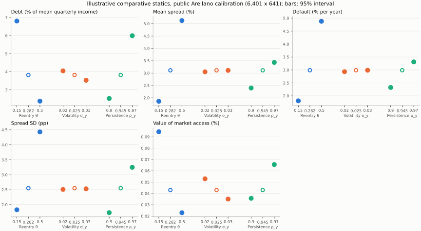

> 🇬🇧 English · 🇪🇸 [Español](es/brief_sovereign_risk.md)

# Sovereign-risk policy brief: reentry, volatility and persistence

This is an illustrative brief on PureMacro's public calibration of the
short-term Arellano (2008) model, not a claim about any country. Nothing is
fitted to targets: the baseline is the calibration whose solver and grid
convergence are checked in the [Arellano replication guide](arellano_replication.md),
and each scenario moves one parameter away from it.

## Question

How do three features of a borrowing economy change its sovereign risk? The
features are the probability of regaining market access after a default
(θ), the volatility of income (σ_y) and the persistence of income (ρ_y). The
outcomes are average debt (the debt chosen in repayment quarters as a
percentage of mean quarterly income, so roughly one quarter of a
debt-to-annual-GDP ratio), the mean spread, the frequency of default, the volatility of spreads, and the value of market access: the
permanent consumption gain, in percent, that would make an economy in
financial autarky with no default cost as well off as one that can borrow
starting from zero debt, with both values averaged over the long-run income
distribution.

## Answer

In this illustrative model, starting from the public calibration and moving one parameter at a time from its low to its high value: a higher reentry probability (θ 0.15 → 0.5) lowers average debt from 6.808% of mean quarterly income to 2.374% of mean quarterly income; raises the mean spread from 1.860% to 5.127%; raises default frequency from 1.807% a year to 4.879% a year; and lowers the value of market access from 0.094% of consumption to 0.023% of consumption. A higher income volatility (σ_y 0.02 → 0.03) lowers average debt from 4.048% of mean quarterly income to 3.529% of mean quarterly income; raises the mean spread from 3.053% to 3.110%; raises default frequency from 2.933% a year to 2.989% a year; and lowers the value of market access from 0.053% of consumption to 0.035% of consumption. A higher income persistence (ρ_y 0.9 → 0.97) raises average debt from 2.521% of mean quarterly income to 5.996% of mean quarterly income; raises the mean spread from 2.398% to 3.434%; raises default frequency from 2.323% a year to 3.311% a year; and raises the value of market access from 0.036% of consumption to 0.066% of consumption. Each number is a mean over 16 simulated paths of 500,000 quarters; the table gives its 95% interval and its grid change.

The levels for θ = 0.5 and ρ_y = 0.97 (marked † in the table) are not grid-converged
by the registered criterion; the directions of their effects are, since the grid
changes are far smaller than the differences between scenarios.

The volatility effect is not monotone. At σ_y = 0.02 / 0.025 / 0.03 the mean spread is 3.053 / 3.114 / 3.110 % and default frequency 2.933 / 2.989 / 2.989 % a year: all of the rise comes between 0.02 and 0.025, and from 0.025 to 0.03 neither rises (paired baseline → σ_y = 0.03 change -0.0033 ± 0.0012 pp for the spread and -0.001 ± 0.011 pp for default, with 95% intervals). These effects are also of the order of the grid changes in the table, so this calibration says little about their sign.

## Results

The table reports, for each scenario on the 6,401 x 641 grid validated for the baseline, the
mean across 16 simulated paths of 500,000 quarters (after a 1,000-quarter
burn), ± the half-width of its 95% Student-t interval across paths. The
number in parentheses, Δ, is the paired change from the 3,201 x 641 grid to
the 6,401 x 641 grid, path by path with the same seeds. The registered
tolerance for that change is 0.10 for each of the four moments (the
replication study's grid tolerance, in the same units). No tolerance is
registered for the value of market access, so its Δ is reported without a
pass or fail. A † marks a scenario where at least one moment's change, plus
its 95% half-width, does not fit inside the tolerance; such rows are reported,
not dropped.

| Scenario | Debt (% of mean quarterly income) | Mean spread (%) | Default (% per year) | Spread SD (pp) | Value of market access (%) |
|---|---:|---:|---:|---:|---:|
| **Baseline** | 3.821 ± 0.025 (Δ +0.006) | 3.114 ± 0.005 (Δ -0.022) | 2.989 ± 0.029 (Δ -0.027) | 2.549 ± 0.005 (Δ -0.034) | 0.043 (Δ +0.000) |
| θ = 0.15 | 6.808 ± 0.037 (Δ +0.006) | 1.860 ± 0.003 (Δ -0.001) | 1.807 ± 0.020 (Δ +0.005) | 1.829 ± 0.003 (Δ -0.001) | 0.094 (Δ +0.000) |
| θ = 0.5 † | 2.374 ± 0.013 (Δ +0.009) | 5.127 ± 0.007 (Δ +0.174) | 4.879 ± 0.035 (Δ +0.167) | 4.429 ± 0.005 (Δ -0.180) | 0.023 (Δ +0.000) |
| σ_y = 0.02 | 4.048 ± 0.024 (Δ +0.003) | 3.053 ± 0.005 (Δ +0.004) | 2.933 ± 0.022 (Δ -0.002) | 2.508 ± 0.004 (Δ -0.016) | 0.053 (Δ +0.000) |
| σ_y = 0.03 | 3.529 ± 0.022 (Δ +0.001) | 3.110 ± 0.006 (Δ -0.027) | 2.989 ± 0.028 (Δ -0.031) | 2.529 ± 0.005 (Δ -0.050) | 0.035 (Δ +0.000) |
| ρ_y = 0.9 | 2.521 ± 0.008 (Δ +0.001) | 2.398 ± 0.003 (Δ +0.003) | 2.323 ± 0.030 (Δ -0.004) | 1.733 ± 0.003 (Δ -0.004) | 0.036 (Δ +0.000) |
| ρ_y = 0.97 † | 5.996 ± 0.060 (Δ -0.001) | 3.434 ± 0.009 (Δ +0.049) | 3.311 ± 0.025 (Δ +0.064) | 3.248 ± 0.007 (Δ -0.129) | 0.066 (Δ +0.000) |

† At least one moment's paired 3,201 x 641 → 6,401 x 641 grid change does not fit the registered 0.10 tolerance (its status is in the record). The row is reported, not dropped.

Grid-change status of the rows marked †: θ = 0.5 (Mean spread (%): grid shift exceeds tolerance; Default (% per year): grid shift exceeds tolerance; Spread SD (pp): grid shift exceeds tolerance); ρ_y = 0.97 (Spread SD (pp): grid shift exceeds tolerance).



Hollow markers are the shared baseline; whiskers are 95% intervals across
paths, most of them narrower than the markers (the value of market access is a
solved quantity, without sampling error).

### Initial crossed refinement of the sensitive scenarios

The follow-up holds the calibration, 16 seeds, 500,000 periods, burn-in and
0.10 tolerances fixed. It solves all four combinations of 6,401/12,801 debt
nodes and 641/1,281 income states. Each cell below is the absolute paired mean
change plus its 95% half-width; **every moment must be at most 0.10**.

| Scenario and refinement | Debt | Mean spread | Default | Spread SD | Verdict |
|---|---:|---:|---:|---:|---|
| θ = 0.5, debt at 1,281 income states | 0.003457 | 0.106816 | 0.118959 | 0.174051 | Failed |
| θ = 0.5, income at 12,801 debt nodes | 0.016915 | 0.039766 | 0.053709 | 0.054342 | Passed |
| ρ_y = 0.97, debt at 1,281 income states | 0.016982 | 0.030946 | 0.031479 | 0.101902 | Failed |
| ρ_y = 0.97, income at 12,801 debt nodes | 0.051721 | 0.032086 | 0.049175 | 0.046211 | Passed |

All eight solves converged, with zero exhaustive-search certification gap and
Bellman residual below `9e-12`. This isolates the remaining issue to debt-grid
moment convergence, rather than an unfinished Bellman solve. For θ = 0.5 the
spread-volatility shift itself is −0.167865 pp; more simulation alone cannot
remove it. For ρ_y = 0.97 the shift is −0.096678 pp, but its uncertainty bound
narrowly misses the criterion. Neither case passes this crossed ladder.

The complete record, including every seed and failed comparison, is
`tests/fixtures/sovereign_brief/sensitive_grid_initial.json`. A further
12,801 → 25,601 debt refinement at both income resolutions is being evaluated
under the same tolerances. Its outcome is not implied by these initial results.

```bash
python -m tools.reference_validation.check_sovereign_sensitive_grids --output grids_initial
python -m tools.reference_validation.check_sovereign_sensitive_grids --extend-from tests/fixtures/sovereign_brief/sensitive_grid_initial.json --output grids_extended
```

## Run it yourself

This example requires the 6.1 development source; 6.0.1 is the latest published
distribution. From a development checkout, install it and run a scenario. On the
maintainer's workstation the θ = 0.15 solve took about 14 minutes,
plus seconds for the measurement, measured under load on a shared machine (load
averages 5/13/27); the whole frozen sweep, seven scenarios on both grids, took
6,851 s (1.9 h), with a peak memory of about 3.4 GB:

```bash
python -m pip install .
python -m puremacro.examples.first_brief_sovereign --scenario theta=0.15 --output brief_theta015
```

Scenarios are `baseline` or `theta=…`, `sigma_y=…`, `rho_y=…`. The output
directory receives `table.md`, `table.csv`, `figure.png`, `record.json` and a
`manifest.json` with the version, grid, seeds and solver certification. For a
quick orientation, all seven scenarios on a coarse grid take minutes:

```bash
python -m puremacro.examples.first_brief_sovereign --sweep --coarse
```

The coarse run prints a caveat: its numbers are for orientation only and
differ from the converged numbers on this page. Add `--lang es` for Spanish
output.

## Assumptions and limits

- **Short-term debt only.** One-period bonds, no maturity choice and no
  restructuring: default wipes out the debt and the economy waits for a
  random reentry with zero debt.
- **Endowment economy.** Income is an exogenous log-AR(1) process (Tauchen
  discretization), so policy cannot change output.
- **Arellano penalty.** In default, income is `min(y, 0.969 ȳ)`.
- **Raw ergodic measurement.** The moments come from
  `puremacro.sovereign.ergodic_moments`: long simulated paths with the
  timing of `SovereignDefaultResult.simulate`, over all repayment quarters,
  with the solver's linear spread `4 * max(0, yield - r*)`. Default frequency
  counts default entries only (not continuing exclusion), as a quarterly
  hazard among quarters with market access, times 4. The replication guide
  instead measures 74-quarter windows before defaults with the study's spread
  convention, and its default frequency is the full-sample
  `1 - (1 - entries / repayment quarters)^4`: compounded, with only repayment
  quarters in the denominator, where this brief uses the linear
  `4 * entries / (repayment quarters + entries)`. The two differences roughly
  cancel for default (2.989 % here against 2.997 % in the guide at the baseline),
  but the guide's other numbers differ from these.
- **What the grid criterion does not bound.** The Δ column bounds the change
  between two grids, not the distance to the infinitely fine limit; the
  replication record shows spread SD still drifting monotonically as the grid
  is refined.
- **No empirical claim.** These are comparative statics of one calibrated
  model, not estimates for any country and not policy recommendations.
