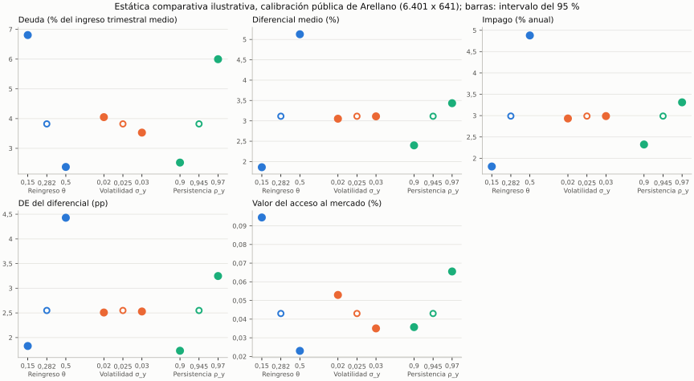

> 🇬🇧 [English](../brief_sovereign_risk.md) · 🇪🇸 Español

# Informe de política sobre riesgo soberano: reingreso, volatilidad y persistencia

Este es un informe ilustrativo sobre la calibración pública de PureMacro del
modelo de Arellano (2008) con deuda de corto plazo; no es una afirmación sobre
ningún país. No se ajusta nada a objetivos: la base es la calibración cuyo
solucionador y convergencia de malla se comprueban en la
[guía de replicación de Arellano](arellano_replication.md), y cada escenario
mueve un solo parámetro respecto de ella.

## Pregunta

¿Cómo cambian tres rasgos de una economía deudora su riesgo soberano? Los
rasgos son la probabilidad de recuperar el acceso al mercado tras un impago
(θ), la volatilidad del ingreso (σ_y) y la persistencia del ingreso (ρ_y). Los
resultados son la deuda media (la deuda elegida en los trimestres de pago como
porcentaje del ingreso trimestral medio, es decir, aproximadamente la cuarta
parte de una razón deuda/PIB anual), el diferencial medio, la frecuencia de
impago, la volatilidad de los diferenciales y el valor del
acceso al mercado: la ganancia permanente de consumo, en porcentaje, que
dejaría a una economía en autarquía financiera y sin coste de impago tan bien
como una que puede endeudarse partiendo de deuda cero, con ambos valores
promediados sobre la distribución de largo plazo del ingreso.

## Respuesta

En este modelo ilustrativo, partiendo de la calibración pública y moviendo un parámetro cada vez de su valor bajo a su valor alto: una mayor probabilidad de reingreso (θ 0,15 → 0,5) baja la deuda media de 6,808 % del ingreso trimestral medio a 2,374 % del ingreso trimestral medio; sube el diferencial medio de 1,860 % a 5,127 %; sube la frecuencia de impago de 1,807 % anual a 4,879 % anual; y baja el valor del acceso al mercado de 0,094 % del consumo a 0,023 % del consumo. Una mayor volatilidad del ingreso (σ_y 0,02 → 0,03) baja la deuda media de 4,048 % del ingreso trimestral medio a 3,529 % del ingreso trimestral medio; sube el diferencial medio de 3,053 % a 3,110 %; sube la frecuencia de impago de 2,933 % anual a 2,989 % anual; y baja el valor del acceso al mercado de 0,053 % del consumo a 0,035 % del consumo. Una mayor persistencia del ingreso (ρ_y 0,9 → 0,97) sube la deuda media de 2,521 % del ingreso trimestral medio a 5,996 % del ingreso trimestral medio; sube el diferencial medio de 2,398 % a 3,434 %; sube la frecuencia de impago de 2,323 % anual a 3,311 % anual; y sube el valor del acceso al mercado de 0,036 % del consumo a 0,066 % del consumo. Cada número es una media sobre 16 trayectorias simuladas de 500.000 trimestres; la tabla da su intervalo del 95 % y su cambio de malla.

Los niveles para θ = 0,5 y ρ_y = 0,97 (marcados con † en la tabla) no están
convergidos en la malla según el criterio registrado; las direcciones de sus
efectos sí, porque los cambios de malla son mucho menores que las diferencias
entre escenarios.

El efecto de la volatilidad no es monótono. Con σ_y = 0,02 / 0,025 / 0,03 el diferencial medio es 3,053 / 3,114 / 3,110 % y la frecuencia de impago 2,933 / 2,989 / 2,989 % anual: toda la subida ocurre entre 0,02 y 0,025, y de 0,025 a 0,03 ninguno sube (cambio emparejado base → σ_y = 0,03 de -0,0033 ± 0,0012 pp en el diferencial y -0,001 ± 0,011 pp en el impago, con intervalos del 95 %). Estos efectos son además del orden de los cambios de malla de la tabla, de modo que esta calibración dice poco sobre su signo.

## Resultados

La tabla presenta, para cada escenario en la malla de 6.401 x 641 validada para la base,
la media sobre 16 trayectorias simuladas de 500.000 trimestres (tras descartar
1.000 trimestres iniciales), ± la semiamplitud de su intervalo t de Student del
95 % entre trayectorias. La cifra entre paréntesis, Δ, es el cambio emparejado
de la malla de 3.201 x 641 a la de 6.401 x 641, trayectoria a trayectoria con
las mismas semillas. La tolerancia registrada para ese cambio es 0,10 en cada
uno de los cuatro momentos (la tolerancia de malla del estudio de replicación,
en las mismas unidades). No hay tolerancia registrada para el valor del acceso
al mercado, de modo que su Δ se informa sin veredicto. Una † marca un
escenario en el que el cambio de al menos un momento, más su semiamplitud del
95 %, no cabe en la tolerancia; esas filas se informan, no se descartan.

| Escenario | Deuda (% del ingreso trimestral medio) | Diferencial medio (%) | Impago (% anual) | DE del diferencial (pp) | Valor del acceso al mercado (%) |
|---|---:|---:|---:|---:|---:|
| **Base** | 3,821 ± 0,025 (Δ +0,006) | 3,114 ± 0,005 (Δ -0,022) | 2,989 ± 0,029 (Δ -0,027) | 2,549 ± 0,005 (Δ -0,034) | 0,043 (Δ +0,000) |
| θ = 0,15 | 6,808 ± 0,037 (Δ +0,006) | 1,860 ± 0,003 (Δ -0,001) | 1,807 ± 0,020 (Δ +0,005) | 1,829 ± 0,003 (Δ -0,001) | 0,094 (Δ +0,000) |
| θ = 0,5 † | 2,374 ± 0,013 (Δ +0,009) | 5,127 ± 0,007 (Δ +0,174) | 4,879 ± 0,035 (Δ +0,167) | 4,429 ± 0,005 (Δ -0,180) | 0,023 (Δ +0,000) |
| σ_y = 0,02 | 4,048 ± 0,024 (Δ +0,003) | 3,053 ± 0,005 (Δ +0,004) | 2,933 ± 0,022 (Δ -0,002) | 2,508 ± 0,004 (Δ -0,016) | 0,053 (Δ +0,000) |
| σ_y = 0,03 | 3,529 ± 0,022 (Δ +0,001) | 3,110 ± 0,006 (Δ -0,027) | 2,989 ± 0,028 (Δ -0,031) | 2,529 ± 0,005 (Δ -0,050) | 0,035 (Δ +0,000) |
| ρ_y = 0,9 | 2,521 ± 0,008 (Δ +0,001) | 2,398 ± 0,003 (Δ +0,003) | 2,323 ± 0,030 (Δ -0,004) | 1,733 ± 0,003 (Δ -0,004) | 0,036 (Δ +0,000) |
| ρ_y = 0,97 † | 5,996 ± 0,060 (Δ -0,001) | 3,434 ± 0,009 (Δ +0,049) | 3,311 ± 0,025 (Δ +0,064) | 3,248 ± 0,007 (Δ -0,129) | 0,066 (Δ +0,000) |

† El cambio de malla emparejado 3.201 x 641 → 6.401 x 641 de al menos un momento no cabe en la tolerancia registrada de 0,10 (su estado está en el registro). La fila se informa, no se descarta.

Estado del cambio de malla de las filas marcadas con †: θ = 0,5 (Diferencial medio (%): el desplazamiento de malla supera la tolerancia; Impago (% anual): el desplazamiento de malla supera la tolerancia; DE del diferencial (pp): el desplazamiento de malla supera la tolerancia); ρ_y = 0,97 (DE del diferencial (pp): el desplazamiento de malla supera la tolerancia).



Los marcadores huecos son la base común; los bigotes son intervalos del 95 %
entre trayectorias, casi todos más estrechos que los marcadores (el valor del
acceso al mercado es una magnitud resuelta, sin error de muestreo).

### Refinamiento cruzado inicial de los escenarios sensibles

El seguimiento conserva la calibración, las 16 semillas, los 500.000 períodos,
el descarte inicial y las tolerancias de 0,10. Resuelve las cuatro combinaciones
de 6.401/12.801 nodos de deuda y 641/1.281 estados de ingreso. Cada celda muestra
el cambio medio emparejado absoluto más su semiamplitud del 95 %;
**todos los momentos deben ser como máximo 0,10**.

| Escenario y refinamiento | Deuda | Diferencial medio | Impago | DE del diferencial | Veredicto |
|---|---:|---:|---:|---:|---|
| θ = 0,5, deuda con 1.281 estados de ingreso | 0,003457 | 0,106816 | 0,118959 | 0,174051 | No superado |
| θ = 0,5, ingreso con 12.801 nodos de deuda | 0,016915 | 0,039766 | 0,053709 | 0,054342 | Superado |
| ρ_y = 0,97, deuda con 1.281 estados de ingreso | 0,016982 | 0,030946 | 0,031479 | 0,101902 | No superado |
| ρ_y = 0,97, ingreso con 12.801 nodos de deuda | 0,051721 | 0,032086 | 0,049175 | 0,046211 | Superado |

Las ocho soluciones convergieron, con brecha de certificación exhaustiva nula
y residuo de Bellman inferior a `9e-12`. El problema pendiente es la convergencia
de los momentos respecto de la malla de deuda, no una iteración de Bellman sin
terminar. Para θ = 0,5 el desplazamiento de la volatilidad del diferencial es
−0,167865 pp; simular más no lo elimina. Para ρ_y = 0,97 el desplazamiento es
−0,096678 pp, pero su cota de incertidumbre rebasa por poco el criterio.
Ningún escenario supera esta malla cruzada.

El registro completo, incluidas todas las semillas y comparaciones fallidas,
está en `tests/fixtures/sovereign_brief/sensitive_grid_initial.json`. Se está
evaluando el refinamiento adicional de deuda 12.801 → 25.601 en ambas
resoluciones de ingreso, con las mismas tolerancias. Estos resultados iniciales
no implican el resultado del estudio ampliado.

```bash
python -m tools.reference_validation.check_sovereign_sensitive_grids --output grids_initial
python -m tools.reference_validation.check_sovereign_sensitive_grids --extend-from tests/fixtures/sovereign_brief/sensitive_grid_initial.json --output grids_extended
```

## Ejecútelo usted mismo

Este ejemplo requiere el código de desarrollo 6.1; 6.0.1 es la distribución
publicada más reciente. Desde un checkout de desarrollo, instálelo y ejecute un escenario. En
la estación de trabajo del mantenedor, la resolución con θ = 0,15 tardó unos
14 minutos, más unos segundos de medición, medidos bajo carga en una
máquina compartida (cargas medias 5/13/27); el barrido congelado completo, siete
escenarios en ambas mallas, tardó 6.851 s (1,9 h), con un pico de memoria de
unos 3,4 GB:

```bash
python -m pip install .
python -m puremacro.examples.first_brief_sovereign --scenario theta=0.15 --lang es --output informe_theta015
```

Los escenarios son `baseline` o `theta=…`, `sigma_y=…`, `rho_y=…`. El
directorio de salida recibe `table.md`, `table.csv`, `figure.png`,
`record.json` y un `manifest.json` con la versión, la malla, las semillas y la
certificación del solucionador. Para orientarse rápidamente, los siete
escenarios en una malla gruesa tardan minutos:

```bash
python -m puremacro.examples.first_brief_sovereign --sweep --coarse --lang es
```

La ejecución gruesa imprime una advertencia: sus cifras son solo orientativas
y difieren de las cifras convergidas de esta página.

## Supuestos y límites

- **Solo deuda de corto plazo.** Bonos a un período, sin elección de
  vencimiento ni reestructuración: el impago borra la deuda y la economía
  espera un reingreso aleatorio con deuda cero.
- **Economía de dotación.** El ingreso sigue un proceso log-AR(1) exógeno
  (discretización de Tauchen), de modo que la política no cambia el producto.
- **Penalización de Arellano.** En impago, el ingreso es `min(y, 0.969 ȳ)`.
- **Medición ergódica bruta.** Los momentos provienen de
  `puremacro.sovereign.ergodic_moments`: trayectorias simuladas largas con la
  cronología de `SovereignDefaultResult.simulate`, sobre todos los trimestres
  de pago, con el diferencial lineal del solucionador `4 * max(0, yield - r*)`.
  La frecuencia de impago cuenta solo las entradas en impago (no la exclusión
  continuada), como tasa trimestral entre los trimestres con acceso al
  mercado, por 4. La guía de replicación mide en cambio ventanas de 74
  trimestres antes de los impagos con la convención de diferencial del
  estudio, y su frecuencia de impago es la de toda la muestra,
  `1 - (1 - entradas / trimestres de pago)^4`: compuesta, con solo los
  trimestres de pago en el denominador, mientras que este informe usa la lineal
  `4 * entradas / (trimestres de pago + entradas)`. Ambas diferencias casi se
  compensan en el impago (2,989 % aquí frente a 2,997 % en la guía para la
  base), pero las demás cifras de la guía difieren de estas.
- **Lo que el criterio de malla no acota.** La columna Δ acota el cambio entre
  dos mallas, no la distancia al límite de malla infinitamente fina; el
  registro de replicación muestra que la DE del diferencial sigue derivando de
  forma monótona al refinar la malla.
- **Ninguna afirmación empírica.** Es estática comparativa de un modelo
  calibrado, no estimaciones para ningún país ni recomendaciones de política.
