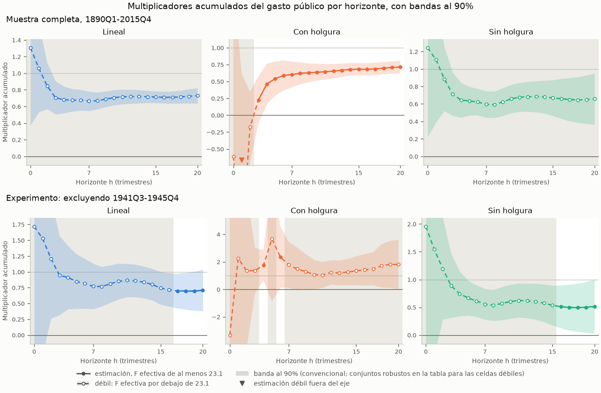

> 🇬🇧 [English](../first_brief_fiscal.md) · 🇪🇸 Español

# Su primer informe fiscal: el multiplicador del gasto, con y sin holgura

Esta página recorre una pregunta completa de política fiscal con datos
públicos. Cuando el gobierno de Estados Unidos compra un dólar más de bienes
y servicios, ¿cuánto sube el PIB en dos y en cuatro años, y cambia la
respuesta cuando la economía tiene holgura? El informe estima las
proyecciones locales de un paso de Ramey y Zubairy (2018) sobre sus datos
trimestrales de Estados Unidos de 1890-2015, que se distribuyen con
puremacro, con las noticias de gasto militar como instrumento. Indica qué
cifras puede sostener el instrumento, repite las estimaciones sin la Segunda
Guerra Mundial, muestra las dos llamadas que se ejecutan con sus propios
datos y explica lo que las cifras no dicen. No hace falta descargar nada
aparte del paquete.

## 1. Instalación

Necesita Python 3.11 o posterior. El informe, y la opción `cumulative=True`
de las proyecciones locales que usa, son posteriores a puremacro 6.1.0
(véase la sección Unreleased del CHANGELOG). Necesita una versión que los
incluya, o una copia del código fuente:

```bash
python -m pip install puremacro    # una versión posterior a 6.1.0
python -m pip install .            # o, desde una copia del código fuente
```

## 2. Ejecución

Un solo comando ejecuta el informe y escribe sus tablas, su figura y su
registro:

```bash
python -m puremacro.examples.first_brief_fiscal --lang es --output fiscal_brief
```

La misma ejecución desde Python:

```python
from puremacro.examples.first_brief_fiscal import run_brief, summary_text

study = run_brief("fiscal_brief", lang="es")
print(summary_text(study["record"], "es"))
```

El directorio de salida contiene `headline.{md,csv,tex}` (las tablas y las
lecturas de abajo), `paths.csv` (todos los horizontes de 0 a 20),
`multipliers.png`, `headline.json` (el registro detrás de esta página) y
`manifest.json` (versiones del paquete y de las bibliotecas, la cita y el
SHA-256 del archivo de datos, la especificación, las advertencias, los
tiempos y el entorno). Opciones: `--exclude INICIO:FIN` añade el experimento
de la sección 4, `--output DIR` fija el directorio (por defecto
`fiscal_brief`) y `--lang en|es` el idioma. Con el experimento, el comando
completo tardó unos 2.3 s de tiempo real en un Apple M3 Pro: 0.5 s para
calcular las estimaciones, 0.4 s para escribir los resultados y el resto
para arrancar Python e importar los paquetes.

## 3. Vista previa: los multiplicadores a dos y cuatro años

El multiplicador en el horizonte h es el PIB adicional sumado en los
trimestres t a t+h, por cada dólar de compras adicionales del gobierno
sumadas en los mismos trimestres. Dos y cuatro años son h = 7 y h = 15, las
ventanas de 8 y 16 trimestres de la Tabla 1 de Ramey y Zubairy. Cada
multiplicador se estima en un solo paso: la suma de ventana del PIB se
regresa sobre la suma de ventana de las compras, instrumentada con el choque
de noticias militares (Ramey 2011), con cuatro rezagos del PIB, de las
compras y de las noticias como controles. Hay holgura cuando la tasa de
desempleo del trimestre anterior era de al menos 6.5%; con holgura y sin
ella, cada coeficiente se estima por separado. Las bandas son al 90%, con
varianzas HAC de h + 1 rezagos.

Una celda es débil cuando su F efectiva, la fuerza del instrumento en esa
celda, queda por debajo de 23.1, el umbral de Montiel Olea y Pflueger (2013)
para un instrumento. La banda convencional de una celda débil no es fiable,
así que el informe muestra una celda débil por su conjunto de Anderson-Rubin
(1949) al 90%, robusto a instrumentos débiles, marcado con †, y nunca por su
estimación puntual. La tabla y la lectura de abajo son la salida congelada de
la ejecución por defecto.

<!-- fiscal-brief:headline -->
| Multiplicador | 2 años (h = 7) | F efectiva | 4 años (h = 15) | F efectiva |
|:---|---:|---:|---:|---:|
| Lineal | [0.57, 0.83] † | 16.0 | [0.65, 0.81] † | 12.0 |
| Con holgura | 0.60 [0.41, 0.79] | 210.2 | 0.68 [0.59, 0.77] | 105.8 |
| Sin holgura | [0.44, 0.82] † | 7.3 | [0.40, 0.89] † | 10.8 |
| Con holgura menos sin holgura | no fiable |  | no fiable |  |

Estimación [banda al 90%]. La diferencia solo se informa donde ningún régimen es débil. † F efectiva por debajo de 23.1: se muestra el conjunto de Anderson-Rubin en lugar de la estimación.
<!-- /fiscal-brief:headline -->



En la figura, las líneas continuas y los puntos rellenos marcan los
horizontes en que el instrumento supera el umbral. Las líneas discontinuas,
los puntos huecos y el sombreado gris marcan los horizontes débiles: ahí la
línea se dibuja solo como referencia, y la cifra que se cita es el conjunto
de Anderson-Rubin. La fila superior es la muestra completa; la inferior, el
experimento de la sección 4.

<!-- fiscal-brief:headline_reading -->
Los multiplicadores son dólares de PIB por dólar de compras del gobierno, ambos acumulados en el horizonte. Lineal: débil a 2 años (F efectiva 16.0, umbral 23.1), con un conjunto al 90% robusto a instrumentos débiles de 0.57 a 0.83; débil a 4 años (F efectiva 12.0, umbral 23.1), con un conjunto al 90% robusto a instrumentos débiles de 0.65 a 0.81. Con holgura: 0.60 a 2 años (banda al 90%: 0.41 a 0.79); 0.68 a 4 años (banda al 90%: 0.59 a 0.77). Sin holgura: débil a 2 años (F efectiva 7.3, umbral 23.1), con un conjunto al 90% robusto a instrumentos débiles de 0.44 a 0.82; débil a 4 años (F efectiva 10.8, umbral 23.1), con un conjunto al 90% robusto a instrumentos débiles de 0.40 a 0.89. La comparación de los multiplicadores con y sin holgura no es fiable en ninguno de los dos horizontes, porque en cada uno al menos un régimen es débil. Con holgura: un solo trimestre, 1941Q4, concentra el 52% de la variación residual del instrumento en ambos horizontes. Sin holgura: un solo trimestre, 1950Q3, concentra el 36% de la variación residual del instrumento en ambos horizontes.
<!-- /fiscal-brief:headline_reading -->

Cómo leerla: en la muestra completa, todas las bandas y todos los conjuntos
robustos quedan entre 0 y 1, con holgura y sin ella. Al 90%, los datos
descartan tanto un multiplicador nulo como uno igual a uno, a dos y a cuatro
años: un dólar más de compras vino con menos de un dólar más de PIB, así que
el resto del PIB (el gasto privado y las exportaciones netas) cayó al subir
las compras. El instrumento solo es fuerte con holgura, desde h = 3. En el
modelo lineal y sin holgura queda por debajo del umbral en todos los
horizontes, así que el informe no puede contrastar si la holgura cambia el
multiplicador. Con holgura, un solo trimestre, 1941Q4, cuando Estados Unidos
entró en la Segunda Guerra Mundial, concentra cerca de la mitad de la
variación residual del instrumento; por eso la sección siguiente quita la
guerra.

## 4. Un experimento: sin la Segunda Guerra Mundial

```bash
python -m puremacro.examples.first_brief_fiscal --exclude 1941Q3:1945Q4 --lang es --output fiscal_brief_sin_guerra
```

La Segunda Guerra Mundial es el mayor episodio de gasto de los datos, y sus
noticias incluyen el mayor choque de la muestra, en 1941Q4. Ramey y Zubairy
(2018, p. 867) excluyen 1941Q3-1945Q4: dejan fuera las observaciones en que
la variable dependiente, el choque o las variables de control rezagadas caen
en ese periodo. El informe aplica la misma regla. El PIB, las compras y las
noticias pasan a faltar en el periodo, se conservan todas las filas, los
controles rezagados se reconstruyen a partir de las series enmascaradas y las
sumas de ventana arrastran el hueco. Un trimestre sale de la muestra, por
tanto, cuando su ventana, su choque o alguno de sus rezagos tocan la guerra:
con h = 7, todos los trimestres de 1939Q4 a 1946Q4. Los dos trimestres que
nombra `--exclude` quedan excluidos.

Junto a las cifras de cada régimen, la lectura informa un diagnóstico de
concentración. En las filas que usa un régimen en un horizonte principal, el
choque de noticias se regresa sobre una constante y los controles. El
diagnóstico es la mayor participación de un solo trimestre en los residuos al
cuadrado, con su fecha, y se informa cuando la participación es de al menos
25%. Con residuos normales y muestras por régimen de estos tamaños (de 153 a
313 trimestres), el mayor trimestre concentra más del 10% en menos de una
muestra de cada cien. Una participación de 25% o más indica, por tanto, que
un solo episodio concentra buena parte de la variación que identifica el
multiplicador del régimen.

<!-- fiscal-brief:experiment -->
| Multiplicador | 2 años (h = 7) | F efectiva | 4 años (h = 15) | F efectiva |
|:---|---:|---:|---:|---:|
| Lineal | [0.54, 2.04] † | 4.8 | [0.50, 1.07] † | 19.6 |
| Con holgura | [0.07, 3.61] † | 20.8 | (-∞, -55.98] ∪ [0.56, ∞) † | 3.2 |
| Sin holgura | [0.25, 1.00] † | 5.7 | [0.18, 0.90] † | 22.3 |
| Con holgura menos sin holgura | no fiable |  | no fiable |  |

Estimación [banda al 90%]. La diferencia solo se informa donde ningún régimen es débil. † F efectiva por debajo de 23.1: se muestra el conjunto de Anderson-Rubin en lugar de la estimación.
<!-- /fiscal-brief:experiment -->

<!-- fiscal-brief:experiment_reading -->
Excluyendo 1941Q3-1945Q4: se descarta todo trimestre cuya ventana, choque o rezagos tocan el periodo, como hacen Ramey y Zubairy con la Segunda Guerra Mundial. Los multiplicadores son dólares de PIB por dólar de compras del gobierno, ambos acumulados en el horizonte. Lineal: débil a 2 años (F efectiva 4.8, umbral 23.1), con un conjunto al 90% robusto a instrumentos débiles de 0.54 a 2.04; débil a 4 años (F efectiva 19.6, umbral 23.1), con un conjunto al 90% robusto a instrumentos débiles de 0.50 a 1.07. Con holgura: débil a 2 años (F efectiva 20.8, umbral 23.1), con un conjunto al 90% robusto a instrumentos débiles de 0.07 a 3.61; débil a 4 años (F efectiva 3.2, umbral 23.1), y su conjunto al 90% robusto a instrumentos débiles no está acotado: los datos no pueden acotarlo. Sin holgura: débil a 2 años (F efectiva 5.7, umbral 23.1), con un conjunto al 90% robusto a instrumentos débiles de 0.25 a 1.00; débil a 4 años (F efectiva 22.3, umbral 23.1), con un conjunto al 90% robusto a instrumentos débiles de 0.18 a 0.90. La comparación de los multiplicadores con y sin holgura no es fiable en ninguno de los dos horizontes, porque en cada uno al menos un régimen es débil. Con holgura: un solo trimestre, 1961Q2, concentra el 41% de la variación residual del instrumento a 2 años y el 48% a 4 años. Sin holgura: un solo trimestre, 1950Q3, concentra el 49% de la variación residual del instrumento en ambos horizontes. Ninguna estimación principal supera el umbral en esta muestra, así que ninguna se compara con la muestra completa. Los valores sin la Segunda Guerra Mundial de la Tabla 3 de Ramey y Zubairy son estimaciones en tres pasos (respuestas al impulso sumadas); las del informe son de un paso, así que no tienen por qué coincidir.
<!-- /fiscal-brief:experiment_reading -->

Cómo leerla: sin la guerra, ninguna celda principal supera el umbral, así que cada
cifra de la tabla es un conjunto robusto a instrumentos débiles, y la mayoría
de los conjuntos son mucho más anchos que en la muestra completa. Con holgura
a cuatro años, los datos no pueden acotar el multiplicador en absoluto. Ramey
y Zubairy (2018, p. 876) también encuentran que, sin la guerra, todos sus
conjuntos de instrumentos parecen débiles en el estado de desempleo alto más
allá de dos años. Estos conjuntos no pueden mostrar que el multiplicador sea
mayor con holgura una vez excluida la guerra, y la identificación vuelve a
apoyarse en episodios aislados: 1961Q2 con holgura y 1950Q3, la movilización
de la guerra de Corea, sin holgura.

## 5. Sus propios datos

El informe son dos llamadas a las proyecciones locales de puremacro con
`cumulative=True`. El bloque de abajo las hace sobre los datos incluidos
exactamente como las haría usted sobre su propio marco trimestral: reemplace
`df` por el suyo. También excluye un periodo con la regla de Ramey y Zubairy.

```python
from puremacro.examples.ramey_zubairy_2018_multipliers import RZ_CONTROLS, load_rz_data
from puremacro.lp import lp_iv, lp_state_dep_iv

df = load_rz_data()        # trimestral, 1890Q1-2015Q4, se conservan todas las filas

# Excluir un periodo con la regla de Ramey y Zubairy: y, g y el instrumento pasan a NaN
# en 1941Q3-1945Q4, las filas se quedan y se reconstruye cada columna de rezagos.
no_war = df.drop(columns=["cumy", "cumg"])    # sumas acumuladas antes de enmascarar
quarter = no_war.index.to_period("Q")
no_war.loc[(quarter >= "1941Q3") & (quarter <= "1945Q4"), ["y", "g", "newsy"]] = float("nan")
for name in RZ_CONTROLS:                      # "g_l2" es g dos trimestres antes
    series, lag = name.rsplit("_l", 1)
    no_war[name] = no_war[series].shift(int(lag))

for label, frame in (("Muestra completa", df), ("Sin 1941Q3-1945Q4", no_war)):
    linear = lp_iv(frame, y="y", x="g", z="newsy", horizons=[7, 15], n_lags=0,
                   controls=RZ_CONTROLS, cumulative=True, anderson_rubin=True)
    state = lp_state_dep_iv(frame, y="y", x="g", z="newsy", state="slack_l",
                            horizons=[7, 15], n_lags=0, controls=RZ_CONTROLS,
                            transition="threshold", threshold=0.5, cumulative=True)
    # Una celda es débil cuando su F efectiva (mop_f; first_stage_f_H y first_stage_f_L
    # por régimen) queda por debajo de mop_cv_10: cite su conjunto de Anderson-Rubin, no su beta.
    print(label)
    print(linear[["mop_f", "mop_cv_10", "beta", "lo", "hi", "ar_lo", "ar_hi", "ar_set_type"]].round(2))
    print(state[["first_stage_f_H", "beta_H", "lo_H", "hi_H",
                 "first_stage_f_L", "beta_L", "lo_L", "hi_L"]].round(2))
```

Lo que necesita su marco, y lo que suponen las llamadas:

- **Un índice trimestral regular, con todas las filas.** Las sumas de ventana
  necesitan trimestres consecutivos, así que `cumulative=True` rechaza un
  índice de fechas o de periodos con un hueco. No elimine filas con valores
  faltantes: en cada horizonte los estimadores omiten las filas cuya ventana,
  instrumento, estado o controles faltan.
- **La escala de Gordon y Krenn.** `y` y `g` son el PIB real y las compras
  reales del gobierno, ambos divididos por la misma estimación de tendencia
  del PIB real potencial (Gordon y Krenn 2010); Ramey y Zubairy ajustan un
  polinomio de sexto grado al logaritmo del PIB real, dejando fuera
  1930-1946. En unidades comunes, el coeficiente es directamente dólares de
  PIB por dólar de compras. En logaritmos sería una elasticidad que necesita
  un factor de conversión, el promedio muestral del PIB sobre las compras, y
  Ramey y Zubairy muestran que, en su muestra larga, esa conversión sesga el
  multiplicador hacia arriba. El choque de noticias se escala igual: las
  noticias nominales divididas por el PIB potencial nominal del trimestre
  anterior (el deflactor del PIB por el PIB real potencial).
- **Controles.** `n_lags=0` con las columnas de rezagos explícitas de
  `RZ_CONTROLS` (cuatro rezagos de `y`, `g` y `newsy`) reproduce los
  controles de Ramey y Zubairy. Mantenga el primer rezago de `y` (`y_l1`)
  entre ellos: así el coeficiente coincide con su forma en suma del PIB (vea
  [Proyecciones Locales](lp.md), "Multiplicadores acumulados").
- **Lo que debe cumplir el instrumento.** Debe ser relevante: mueve las
  compras en la ventana. Revise la F efectiva en cada horizonte (`mop_f`) y
  por régimen (`first_stage_f_H`, `first_stage_f_L`); por debajo de
  `mop_cv_10` (23.1 con un instrumento) la banda no es fiable y la cifra que
  se cita es el conjunto de Anderson-Rubin. Debe ser exógeno: sin relación
  con las demás fuerzas que mueven el PIB, en la fecha del choque y antes y
  después de ella, una vez incluidos los controles. La relevancia se puede
  medir; la exogeneidad no, y se argumenta a partir de cómo se construye la
  serie. Las noticias militares registran cambios en el gasto de defensa
  esperado debidos a acontecimientos políticos y militares (Ramey 2011).
- **El estado se fecha en t-1.** Cada trimestre se clasifica por el estado de
  la economía antes del choque: `slack_l` vale 1 cuando la tasa de desempleo
  del trimestre anterior era de al menos 6.5%. A partir de su propia tasa,
  `(df["unemp"] >= 6.5).astype(float).where(df["unemp"].notna()).shift(1)`
  conserva como faltante una tasa faltante en lugar de leerla como "sin
  holgura". El estado es un indicador 0/1, así que `threshold=0.5` lo separa,
  y cada coeficiente es propio de cada régimen por defecto
  (`interact="all"`).
- **Excluir un periodo.** Como en el bloque: ponga `y`, `g` y el instrumento
  en NaN en el periodo, conserve las filas y reconstruya cada columna de
  rezagos a partir de las series enmascaradas. No reutilice nunca sumas
  acumuladas calculadas antes de enmascarar (`cumy` y `cumg` en el marco
  incluido). Así, un trimestre sale del horizonte h cuando su ventana, su
  choque o alguno de sus rezagos tocan el periodo.
- **El conjunto de Anderson-Rubin de un régimen.** `lp_state_dep_iv` informa
  bandas y F por régimen, pero ningún conjunto de Anderson-Rubin. El informe
  toma el conjunto de cada régimen de `lp_iv(..., anderson_rubin=True)` sobre
  un marco cuyo instrumento es NaN fuera del régimen, por ejemplo
  `frame.assign(newsy=frame["newsy"].where(frame["slack_l"] == 0))` para sin
  holgura (vea la sección 6).
- **Sin un choque narrativo: la vía de Blanchard y Perotti.** Si no existe
  una serie de noticias para su economía, la alternativa habitual sigue a
  Blanchard y Perotti (2002): la parte de las compras corrientes que los
  controles rezagados no predicen se trata como un choque. Regrese `g` sobre
  una constante y los rezagos de `y` y `g`, y pase el residuo como `z`, sin
  rezagos de noticias entre los controles. Esto añade un supuesto que la
  serie de noticias no necesita: las compras no responden a la economía
  dentro del trimestre, porque los presupuestos tardan en decidirse y
  ejecutarse. Su punto débil es la anticipación: Ramey (2011) muestra que el
  gasto militar suele conocerse trimestres antes de ejecutarse. Ramey y
  Zubairy encuentran este choque relevante en horizontes cortos y a menudo
  débil pasados uno o dos años.

## 6. Supuestos y límites

- **Datos históricos de Estados Unidos dominados por guerras.** La muestra es
  1890-2015, y los mayores choques de noticias vienen de la Primera Guerra
  Mundial, la Segunda Guerra Mundial y la guerra de Corea. Los multiplicadores
  los determinan esos episodios y las compras de defensa que siguieron a las
  noticias; trasladarlos a otro gasto, a otro país o al presente es un
  supuesto.
- **Relevancia y exogeneidad del instrumento.** La relevancia se mide,
  horizonte por horizonte y régimen por régimen, con la F efectiva. La
  exogeneidad se supone: las noticias militares deben mover el PIB solo a
  través de las compras. El racionamiento de guerra, las restricciones de
  capacidad, el reclutamiento o los impuestos anunciados con las mismas
  noticias la romperían; Ramey y Zubairy excluyen la Segunda Guerra Mundial
  para comprobar si el racionamiento y las restricciones de capacidad
  determinan sus resultados.
- **Instrumentos débiles por horizonte y régimen.** En la muestra completa el
  instrumento solo es fuerte con holgura, desde h = 3; sin la Segunda Guerra
  Mundial es débil en todas las celdas principales. Una celda débil se
  informa por su conjunto de Anderson-Rubin, cuya cobertura no depende de la
  fuerza del instrumento, a cambio de ser más ancho; un conjunto no acotado
  significa que los datos no pueden acotar el multiplicador. La Figura 4 de
  Ramey y Zubairy (p. 868) muestra el mismo patrón para las noticias
  militares en la muestra completa: por debajo del umbral en todos los
  horizontes en el modelo lineal y con desempleo bajo, y por encima con
  desempleo alto después de los primeros trimestres.
- **Momento del estado.** El estado se fecha antes del choque (el desempleo
  en t-1), así que el choque no puede mover el estado que lo clasifica. Aun
  así, el estado depende de choques anteriores. Gonçalves, Herrera, Kilian y
  Pesavento (2024) muestran que, cuando el estado depende de choques
  macroeconómicos, las proyecciones locales dependientes del estado solo
  recuperan la respuesta condicional a un choque infinitesimal, no la
  respuesta a choques mayores; en sus simulaciones, los multiplicadores
  fiscales pueden desviarse hasta 40 por ciento. Los choques de noticias
  detrás del régimen con holgura incluyen el mayor de la muestra, así que lea
  los multiplicadores por régimen como respuestas a cambios pequeños de las
  compras.
- **Los conjuntos de Anderson-Rubin por régimen son una aproximación.**
  Vienen de regresiones enmascaradas por régimen: `lp_iv` con el instrumento
  como faltante fuera del régimen. Las estimaciones son idénticas a las del
  régimen, pero las sumas HAC tratan como vecinos los trimestres no contiguos
  de un régimen, así que el conjunto se parece al de la regresión conjunta,
  pero no es igual.
- **Ancho de banda.** Los errores estándar de Ramey y Zubairy usan un ancho
  de banda HAC automático (su nota 17), mientras que el informe usa h + 1
  rezagos para las bandas, la F efectiva y los conjuntos de Anderson-Rubin
  por igual. Por eso solo se comparan las estimaciones puntuales con sus
  tablas: con h = 7 y 15, las estimaciones del informe en la muestra completa
  coinciden con su Tabla 1 a dos decimales en todas las celdas; esto
  comprueba la replicación y no convierte en citables las estimaciones
  puntuales de las celdas débiles.
- **Un paso, no tres.** Los valores sin la Segunda Guerra Mundial de la Tabla
  3 de Ramey y Zubairy son estimaciones en tres pasos, respuestas al impulso
  sumadas (su nota 26), mientras que las del informe son de un paso. Los dos
  métodos coinciden solo cuando todas las regresiones usan la misma muestra
  (su nota 14), y la exclusión lo impide, así que el experimento no se
  compara con su Tabla 3.
- **Unidades.** Los multiplicadores son dólares de PIB por dólar de compras
  del gobierno, ambos acumulados en los trimestres t a t+h: un multiplicador
  integral, no el cociente entre la respuesta máxima del PIB y el choque
  inicial de gasto, la definición de Blanchard y Perotti (2002).
- **No es un multiplicador de impuestos ni una comparación de
  financiamiento.** El informe mide las compras de bienes y servicios del
  gobierno, no las transferencias ni los cambios de impuestos, y no separa
  cómo se pagaron las compras: el gasto de guerra vino con impuestos, deuda y
  racionamiento en proporciones que la estimación promedia. No dice nada
  sobre financiar con deuda frente a hacerlo con impuestos.

## 7. Cómo citar

Si publica resultados calculados con los datos incluidos, cite el artículo y
los datos:

Ramey, V. A. & Zubairy, S. (2018). Government Spending Multipliers in Good Times and in Bad: Evidence from US Historical Data. Journal of Political Economy, 126(2), 850-901. https://doi.org/10.1086/696277

Los datos son un snapshot congelado de las series trimestrales del archivo de
replicación de Valerie Ramey para ese artículo
(`Ramey_Zubairy_replication_codes.zip`, en su
[página de investigación](https://econweb.ucsd.edu/~vramey/research.html)),
incluido como `puremacro/replication/data/rz2018.csv`; el `manifest.json` de
cada ejecución registra su SHA-256. Para citar puremacro, use los metadatos
de `CITATION.cff` en el repositorio.

Otras obras en las que se apoya esta página:

- Anderson, T. W. & Rubin, H. (1949). Estimation of the Parameters of a Single Equation in a Complete System of Stochastic Equations. The Annals of Mathematical Statistics, 20(1), 46-63. https://doi.org/10.1214/aoms/1177730090
- Blanchard, O. & Perotti, R. (2002). An Empirical Characterization of the Dynamic Effects of Changes in Government Spending and Taxes on Output. The Quarterly Journal of Economics, 117(4), 1329-1368. https://doi.org/10.1162/003355302320935043
- Gonçalves, S., Herrera, A. M., Kilian, L. & Pesavento, E. (2024). State-dependent local projections. Journal of Econometrics, 244(2), 105702. https://doi.org/10.1016/j.jeconom.2024.105702
- Gordon, R. & Krenn, R. (2010). The End of the Great Depression 1939-41: Policy Contributions and Fiscal Multipliers. NBER Working Paper 16380. https://doi.org/10.3386/w16380
- Montiel Olea, J. L. & Pflueger, C. (2013). A Robust Test for Weak Instruments. Journal of Business & Economic Statistics, 31(3), 358-369. https://doi.org/10.1080/00401706.2013.806694
- Ramey, V. A. (2011). Identifying Government Spending Shocks: It's All in the Timing. The Quarterly Journal of Economics, 126(1), 1-50. https://doi.org/10.1093/qje/qjq008
