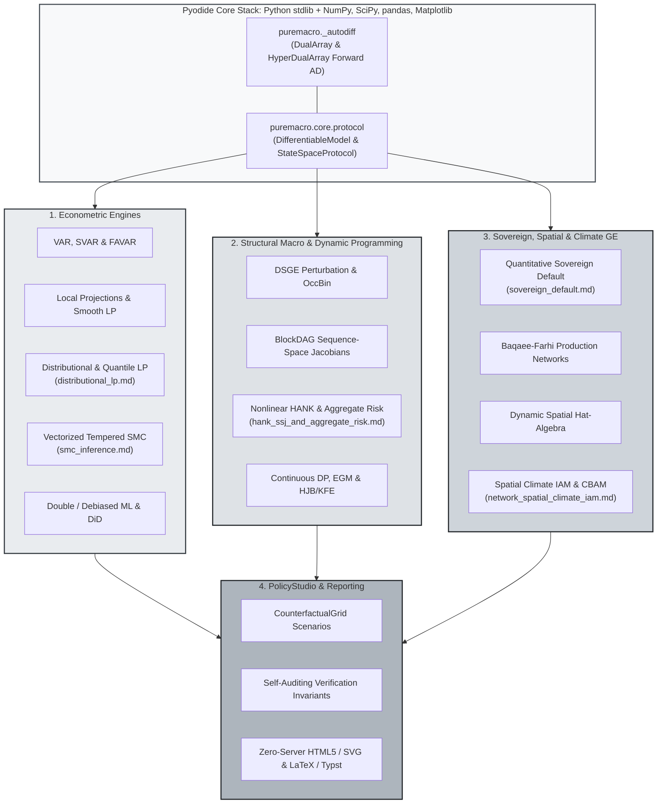

> 🇪🇸 Español · 🇬🇧 [English](../index.md)

# puremacro

**Macroeconometría y modelos estructurales sobre el núcleo científico de Python.**

[](https://pypi.org/project/puremacro/)
[](https://www.python.org/downloads/)
[](https://jalonso1979.github.io/puremacro/)
[](https://opensource.org/licenses/MIT)

Estime efectos de política, compare modelos económicos y exporte resultados
para una nota de investigación o de política. Comience con Python 3.11 o posterior:

```bash
python -m pip install puremacro
```

| Comience por su tarea | Primeros pasos |
|---|---|
| **Analizar datos** | Estime un multiplicador del gasto público con el [informe fiscal](first_brief_fiscal.md) o una respuesta a un choque con el [inicio rápido](quickstart.md); luego explore las [fuentes de datos](micro_data.md) y los [flujos de investigación](research_workflows.md). |
| **Simular políticas** | Declare un modelo de hogares con [programación dinámica](dp.md), estudie la [transmisión monetaria](monetary_transmission.md) o construya un [contrafactual comercial](trade_accounting.md). |
| **Redactar un informe de política** | Ejecute un [experimento arancelario con datos públicos](first_brief_tariffs.md) y lea los efectos de bienestar nacionales y por hogares. |
| **Aprender o enseñar** | Elija una [ruta de cuadernos](notebooks.md) o use el [curso bilingüe y sus laboratorios interactivos](https://github.com/jalonso1979/puremacro/tree/main/curso). Use la edición fija del curso indicada abajo. |

**Estado comprobado el 2026-11-05:** **6.2.0** está publicada en [PyPI](https://pypi.org/project/puremacro/6.2.0/), y `pip install puremacro` la instala. Sucede a 6.1.0 (publicada el 2026-11-03) y 6.0.1 (publicada el 2026-10-29); las etiquetas 5.8.0, 5.9.0 y 6.0.0 nunca se publicaron (v6.0.0 falló en CI).
Consulte las [pruebas recomendadas y próximos hitos](research_reliability.md).
Estas páginas siguen la versión 6.2.0; consulte el
[historial de cambios](https://github.com/jalonso1979/puremacro/blob/main/CHANGELOG.md) y use la documentación correspondiente
a su versión instalada.

Disponible desde 6.0.1 (introducido en la etiqueta fuente 6.0.0): [Diferenciación automática directa y protocolo de modelos diferenciables](autodiff_and_protocol.md), [SMC templado vectorizado](smc_inference.md), [HANK no lineal y riesgo agregado de segundo orden](hank_ssj_and_aggregate_risk.md), [Default soberano cuantitativo](sovereign_default.md), [Proyecciones locales distribucionales](distributional_lp.md) y [Redes de producción, IAM climático espacial y PolicyStudio](network_spatial_climate_iam.md).

También se incluye el desarrollo de ciclos anteriores: [flujos DSGE y elección del método](dsge_workflows.md), [modelos no lineales](dsge_nonlinear.md), [transiciones y anuncios](dsge_transitions.md) y [precisión local/global](dsge_global.md). Consulte los [límites de la inferencia experimental](dependence_bootstrap.md) y las [auditorías de resultados resueltos admitidos](result_audits.md). Si usa `STEADY_STATE()` en trayectorias no lineales, consulte el [aviso de corrección](ADVISORY.md) y vuelva a ejecutar los cálculos afectados.

La [edición bilingüe del curso `course-2026A-5.5.0`](https://github.com/jalonso1979/puremacro/blob/course-2026A-5.5.0/curso/notebooks/README.md)
fija `puremacro==5.5.0` y requiere **Python 3.12 o posterior**. Se ejecutaron los
72 cuadernos con el [wheel candidato documentado](https://github.com/jalonso1979/puremacro/blob/course-2026A-5.5.0/curso/validation/README.md),
datos congelados y respuestas de modelos de lenguaje en caché, incluidas las
secciones obligatorias de DP y texto. El [registro de publicación](https://github.com/jalonso1979/puremacro/releases/tag/v5.5.0)
verifica que el wheel publicado contiene los mismos archivos de ejecución. Los refrescos de datos y
los modelos locales en vivo siguen siendo opcionales y no formaron parte de
esa validación. Siga las instrucciones de la edición; la biblioteca conserva
el soporte de Python 3.11+.

## ¿Qué es puremacro?

`puremacro` reúne estimadores econométricos y modelos macroeconómicos cuantitativos
sobre NumPy, SciPy, pandas y Matplotlib, sin extensiones compiladas propias.
El destino soportado es una instalación local en una estación de trabajo.
El núcleo numérico también funciona bajo Pyodide / WebAssembly; los flujos en
navegadores y tabletas tienen soporte limitado por los formatos de archivo,
el acceso a la red y la capacidad de cómputo. Consulte la
[guía de ejecución](tablet.md) y el [estado de validación estructural](STRUCTURAL_VALIDATION_STATUS.md)
para conocer el alcance de la evidencia.



### Subsistemas Clave

1. **Modelos DSGE Estructurales y Paridad con Dynare**:
   - **Analizador Nativo de Archivos `.mod` de Dynare y CLI `puremacro-dynare`**: Inspección del soporte de comandos, seguida de carga y resolución del subconjunto `.mod` admitido en Python puro ([Inspección y límites](dsge_mod_inspection.md)).
   - **Scores de Verosimilitud**: Recursión analítica de Kalman para parámetros estructurales en la verosimilitud estacionaria de primer orden soportada; las derivadas estructurales de entrada pueden usar diferencias finitas. NUTS también ofrece gradientes numéricos y suministrados por el usuario; la interfaz de estimación determina su selección y las alternativas automáticas ([Guía](dsge_estimation.md)).
   - **HMC y NUTS en Python Puro**: Monte Carlo Hamiltoniano con adaptación dual averaging de tamaño de paso, adaptación de masa diagonal y diagnósticos de convergencia $\hat{R}$ divididos, sin normalización por rangos.
   - **Política Discrecional Óptima vs Compromiso**: Iteraciones matriciales de Riccati de Dennis (2007) para política discrecional perfecta en el sentido de Markov frente a compromiso en perspectiva atemporal, descomponiendo los sesgos de inflación y estabilización.
   - **Modelado Híbrido DSGE-VAR**: Optimización de previas e identificación estructural DSGE-VAR($\lambda$) de Del Negro y Schorfheide (2004).
   - **Choques Anticipados de Noticias**: Aumento del espacio de estados con operadores nilpotentes que preservan la determinancia de Blanchard-Kahn.
   - **Filtrado No Lineal de Partículas y MS-DSGE**: Filtros de partículas bootstrap y auxiliares con volatilidad estocástica y soluciones racionales con cambio de régimen de Markov de Foerster et al. (2016) con GIRFs analíticas cerradas.
   - **Perturbación y Restricciones Ocasionalmente Activas**: Perturbación podada para modelos sin restricciones y OccBin lineal por partes para regímenes con restricciones activas ([Guía](dsge_build.md)). La función `solve_pruned_occbin` admite OccBin lineal, incluidos choques anticipados, y trayectorias de segundo orden sin restricciones activas con una sola innovación inicial; los episodios no lineales con restricciones activas y las innovaciones futuras anticipadas no lineales generan errores explícitos ([Límites soportados](dsge_higher_order.md)).

2. **Modelos de Agentes Heterogéneos (DP Declarativa y HANK)**:
   - **Modelos de Hogares como Ecuaciones**: Declare estados, decisiones, recompensas y restricciones con `dp.Model`, y elija VFI, EGM, HJB en tiempo continuo o una resolución de Krusell–Smith admitida ([Guía](dp.md)).
   - **HANK en el Espacio de Secuencias** (Auclert, Bardóczy, Rognlie y Straub 2021, *Econometrica*): Modelos de equilibrio general con mercados incompletos resueltos en $\mathcal{O}(T^3)$.
   - **Algoritmo de Noticias Falsas (Fake News)**: Cálculo acelerado $\mathcal{O}(T^2)$ de jacobianos de consumo en el espacio de secuencias mediante vectores de expectativa e identidades de acumulación.
   - **Puente HANK en Espacio de Secuencias**: Declaración directa del bloque `hetagent_block` en archivos `.mod` estándar de Dynare.
   - **Transferencias Fiscales Focalizadas**: Respuestas dinámicas de consumo y multiplicadores acumulados por deciles de riqueza.
   - **HJB en Tiempo Continuo**: Esquemas **implícitos** de M-matriz upwind en diferencias finitas de Achdou et al. (2022), la ecuación de Kolmogorov hacia adelante adjunta para la densidad estacionaria y el equilibrio general de Aiyagari en tiempo continuo.
   - **Transiciones No Lineales en HANK y Riesgo Agregado de 2.° Orden**: Jacobianos en espacio de secuencias de equilibrio general composables con `BlockDAG`, transiciones no lineales con actualizaciones Good Broyden y una demostración algebraica reducida de riesgo agregado con momentos prescritos ([Guía](hank_ssj_and_aggregate_risk.md)).

3. **Motores Econométricos y Proyecciones Locales**:
   - **`LPResult` Unificado**: Proyecciones locales estandarizadas (`lp_hac`, `lp_iv`, `lp_state_dep`, `panel_lp`) con errores estándar Newey-West HAC, fixed-$b$ y Driscoll-Kraay.
   - **Proyecciones Locales Distribucionales y por Cuantiles**: Funciones de respuesta a impulsos transversales de participaciones y cuantiles que satisfacen estrictamente la propiedad de suma exacta ($\sum \beta_b = 0$) con covarianza Driscoll–Kraay y puente estructural directo hacia modelos HANK con `HetBlock` ([Guía](distributional_lp.md)).
   - **Monte Carlo Secuencial (SMC) Templado y Vectorizado**: Esquemas adaptativos de templado $\phi_n$, mutaciones de Langevin/Hamiltoniano guiadas por el gradiente analítico y estimación de la densidad marginal de datos ($\ln p(Y)$) ([Guía](smc_inference.md)).
   - **SVAR y FAVAR**: Cholesky, Blanchard-Quah, restricciones de signo, restricciones narrativas de signo, instrumentos externos/proxy, max-share/noticias y VAR aumentado por factores.
   - **Diferencias en Diferencias Modernas**: Estimadores con adopción escalonada robustos a heterogeneidad en el tratamiento (Callaway y Sant'Anna, Sun y Abraham, Borusyak-Jaravel-Spiess, SDID, Honest DiD).
   - **Econometría Espacial y VAR Global**: Errores estándar Conley HAC, modelos autorregresivos espaciales (`sar`, `sem`, `sdm`), proyecciones locales espaciales y VAR Global de Pesaran (`var.gvar`).

4. **Suites de Política Macroeconómica Aplicada**:
   - **Default Soberano Cuantitativo y Paradas Repentinas**: Modelos de Arellano (2008) y Chatterjee–Eyigungor (2012) con deuda de largo plazo y choques de preferencias de valor extremo, restricciones de colateral de Mendoza (2010), descomposiciones de la estructura temporal de spreads y contrafactuales de reestructuración de deuda ([Guía](sovereign_default.md)).
   - **Postura Monetaria y Gráficos de Abanico**: Evaluación de la postura monetaria en tiempo real frente a reglas de Taylor contrafactuales, proyecciones en abanico y sentimiento textual en comunicados de bancos centrales ([Guía](notebooks.md)).
   - **Nowcasting en Tiempo Real y Descomposición de Noticias**: Modelos de factores dinámicos (DFM) de frecuencia mixta (Giannone, Reichlin y Small), tratamiento de extremos irregulares (ragged edges) y atribución de sorpresas de datos ([Guía](nowcast.md)).
   - **Riesgo Macroprudencial y Estabilidad Financiera**: Densidades condicionales skew-$t$ de Growth-at-Risk (GaR) y redes de desbordamiento de riesgo sistémico de Diebold-Yilmaz ([Guía](notebooks.md)).
   - **Política Fiscal y DSA Soberano**: Multiplicadores fiscales trimétodo y análisis estocástico de sostenibilidad de la deuda pública ante escenarios de estrés macroeconómico y climático.

5. **Ecosistema de Datos Globales y Paneles Modulares**:
   - **Microdatos de Encuestas**: Los lectores de ACS, CPS, SCF y ENIGH conservan el diseño muestral disponible en cada fuente; la interfaz común `MicroFrame` ofrece las estadísticas y estimaciones de incertidumbre admitidas ([Guía](micro_data.md)).
   - **Emisiones y Datos Climáticos**: Cuentas de emisiones y gases de efecto invernadero del Banco Mundial WDI y la OCDE SDMX a nivel internacional y sectorial ([Guía](data_ecosystem.md)).
   - **Balances Energéticos y Materias Primas**: Consumo de energía primaria, cuotas de generación limpia y suites ampliadas de precios de materias primas del Pink Sheet del Banco Mundial ([Guía](data_ecosystem.md)).
   - **Estabilidad Financiera Internacional**: Curvas de rendimiento soberano (10Y/2Y), tasas de política monetaria, brechas de crédito del BPI (BIS) y precios reales de vivienda ([Guía](data_ecosystem.md)).
   - **Constructores Modulares de Paneles**: Funciones de alto nivel `build_climate_panel` y `build_financial_panel` con armonización temporal automatizada (M$\to$Q, A$\to$Q).

6. **ML Causal, Agentes Heterogéneos en Tiempo Continuo y Tiempo Real Regional**:
   - **Aprendizaje Automático Doble / Desesgado**: Regresión parcialmente lineal de Chernozhukov et al. (2018) con puntajes ortogonales de Neyman-Robinson, validación cruzada por $K$ bloques y aprendices penalizados en NumPy puro: únicamente lasso y ridge, sin red elástica.
   - **HJB Implícito, KFE Adjunta y EG de Aiyagari Continuo**: Iteración de política sobre una M-matriz dispersa, una densidad estacionaria normalizada con pesos de cuadratura trapezoidal que integra a uno también en mallas no uniformes, y un bucle de equilibrio general cuyo indicador `converged` significa $|K^s - K^d| \le$ `tol_ge`.
   - **OccBin Multirrestricción**: $M \ge 2$ restricciones ocasionalmente activas simultáneas, con máscara de bits de régimen (el bit $k$ se activa cuando la restricción $k$ está activa) y no convergencia reportada como `converged=False` más una advertencia que nombra cada motivo ([Guía](dsge_build.md)).
   - **Inferencia con Instrumentos Débiles de Montiel Olea-Pflueger**: Valores críticos del estadístico $F$ efectivo a partir de la forma cerrada $\chi^2_{K,\,1-\alpha}(K/\tau)/K$, y conjuntos de Anderson-Rubin multiinstrumentales invertidos de forma exacta y no sobre una malla ([Guía](lp.md)).
   - **Conectores en Tiempo Real de América Latina**: Banco de México, INEGI, Banco Central do Brasil y Banco Central de Chile. Estas cuatro fuentes publican únicamente la edición vigente, así que su fecha de añada es la fecha de *captura* local y el historial de revisiones sólo se acumula con capturas repetidas en días distintos.

7. **Redes de Producción, Comercio Internacional e IAM Climático Espacial**:
   - **Redes de Producción e IAM Climático Espacial**: Agregación insumo-producto de segundo orden de Baqaee–Farhi, álgebra de cambios proporcionales (hat-algebra) dinámica de migración espacial de Caliendo–Parro–Rossi-Hansberg y modelo IAM climático multirregional con Mecanismos de Ajuste en Frontera por Carbono (CBAM) ([Guía](network_spatial_climate_iam.md)).
   - **Contrafactuales de Política**: Modelos comerciales de varios países y sectores con contabilidad de productor/comprador, recaudación fiscal explícita y un cierre de equilibrio explícito ([Guía](trade_accounting.md)).
   - **Datos OCDE Reproducibles**: La tabla OCDE ICIO incluida (edición 2023, año de referencia 2019) abarca los 19 países miembros del G20 más el resto del mundo y 20 secciones CIIU, con un script de reconstrucción y atribución a la fuente ([Datos y modelos](spatial_and_trade_ge.md)).
   - **Incidencia en los Hogares**: Comparaciones estáticas de bienestar EV/CV condicionadas a los precios de comprador, cambios de ingreso y transferencias fiscales suministrados; la demanda de los hogares no retroalimenta el equilibrio comercial ([Guía](trade_distributional.md)).

8. **Generación de Informes de Nivel de Publicación y PolicyStudio**:
   - **PolicyStudio Declarativo y HTML5 Interactivo Sin Servidor**: Matrices de escenarios contrafactuales con verificación automatizada de invariantes numéricos e informes visuales interactivos autocontenidos ([Guía](network_spatial_climate_iam.md)).
   - **Exportación para Manuscritos**: Exportación de tablas con calidad de imprenta directamente a **LaTeX** (`.to_latex()`), **Typst** (`.to_typst()`) y **Markdown** (`.to_markdown()`), con errores estándar y estrellas de significancia ([Guía](reporting.md)).

9. **Ejecución en Cualquier Dispositivo**:
   - Núcleo numérico compatible con Pyodide para cuadernos en el navegador, con soporte limitado en tabletas y navegadores ([Guía](tablet.md)), herramientas para descargar cómputo a Google Colab (`runtime.colab`), ejecución segmentada (`longrun`) y cartuchos portátiles `.pmz` (`pocket`).

10. **Motor de Diferenciación Automática Directa y Protocolo Unificado de Modelos Diferenciables**:
    - **Diferenciación Automática Directa**: Derivadas exactas de primer y segundo orden mediante `DualArray` y `HyperDualArray` a través de ufuncs de NumPy, resolución de sistemas lineales implícitos y ecuaciones de Sylvester sin dependencias de frameworks externos ([Guía](autodiff_and_protocol.md)).
    - **Protocolo Unificado `DifferentiableModel`**: Interfaz con gradientes DSGE nativos y DAG condicionales, demostraciones explícitas y errores para operaciones no implementadas ([Guía](autodiff_and_protocol.md)).

---

## Instalación

La orden al inicio instala el paquete básico. Las herramientas opcionales añaden
soporte para formatos de archivo y utilidades para cuadernos:

Los lectores de parquet y Excel (las lecciones ENOE del curso, `build_all`, el atlas de choques) necesitan los motores opcionales de formato de archivo:

```bash
pip install "puremacro[io]"
```

O con herramientas completas para cuadernos interactivos:

```bash
pip install "puremacro[notebooks]"
```
