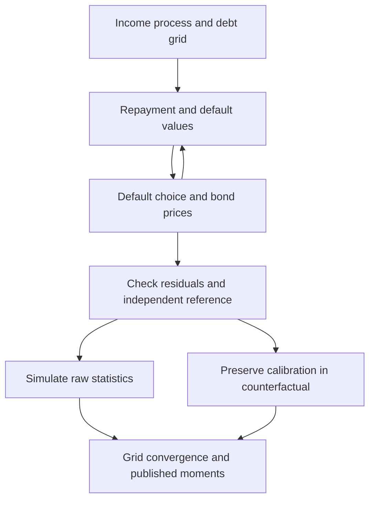

> 🇬🇧 [English](../sovereign_default.md) · 🇪🇸 Español

# Impago soberano y reestructuración

## Alcance de la comprobación independiente

Para deuda a corto plazo (`delta=1`, `kappa=0`), impago determinista
(`sigma_eps=0`) y la penalización de producto de Arellano, cálculos independientes
contrastan ecuaciones, precios y políticas. Se reproducen el solucionador Fortran
archivado y la medición MATLAB; la base pública también supera su criterio
registrado de malla. No se afirma una reproducción exacta de la tabla publicada:
véase la [comparación con el código original y las mallas](arellano_replication.md).

Para una estática comparativa ilustrativa con este modelo validado, consulte el
[informe de política sobre riesgo soberano](brief_sovereign_risk.md).

PureMacro 6.1.0 agrega [referencias independientes en mallas pequeñas](sovereign_extensions_validation.md)
para el operador suavizado de largo plazo, la reestructuración y el planificador
con colateral. Los momentos publicados de las extensiones y su convergencia
económica de malla siguen pendientes.
`dq_db` deriva el interpolante de precios, no todo el equilibrio.
La monotonicidad puede imponerse; la referencia independiente la desactiva.

## Convenciones de deuda e impago

$b$ positivo es deuda; $b$ negativo es ahorro. A corto plazo, el consumo con
reembolso es $c=y-b+q(b',y)b'$. El gobierno compara

$$
V^R(b,y)=\max_{b'}\{u(y-b+q(b',y)b')+\beta E[V(b',y')\mid y]\}
$$

con el valor de impago

$$
V^D(y)=u(h(y))+\beta E[\theta V(0,y')+(1-\theta)V^D(y')\mid y].
$$

Una dispersión de preferencias cero da el máximo determinista; una dispersión
positiva usa log-sum-exp y probabilidades logísticas. El costo de Arellano es
$h(y)=\min(y,0.969\bar y)$ con ingreso medio estacionario $\bar y$. El reingreso
elimina la deuda, incluso cuando la malla permite ahorro.

Tras un impago en $t$, el primer sorteo de reingreso ocurre en $t+1$. Si tiene
éxito, permite reembolsar o volver a incumplir **en ese trimestre**, con deuda
heredada cero. Los diagnósticos del solucionador y `result.simulate()` usan esta
convención y comienzan con deuda cero. Las mallas generadas incluyen un nodo
cero exacto: cuando permiten ahorro y deuda, reemplazan el nodo interior más
cercano, conservando extremos y número de puntos. Estas mallas exigen `n_b >= 3`.

La API de desarrollo 6.1 también acepta `debt_grid=coordenadas`: un vector
finito y estrictamente creciente con al menos dos nodos y un cero exacto. Copia
las coordenadas, conserva todos los nodos y sustituye `n_b`, `b_min` y `b_max`.
Permite reducir el espaciamiento en regiones sensibles sin cambiar el soporte.
La reestructuración de vencimientos conserva esas mallas; sus tangentes de
precios usan derivadas PCHIP ponderadas por el espaciamiento y truncadas en cero.
Las llamadas sin `debt_grid` conservan las mallas y los resultados existentes.

| Parámetro | Significado | Caso de referencia |
|---|---|---|
| `sigma_eps` | Dispersión de preferencias de impago | `0.0`, determinista |
| `delta`, `kappa` | Tasa de vencimiento y cupón | `1.0`, `0.0`, deuda a un período |
| `y_penalty_type` | Especificación de producto en impago | `"arellano"` |
| `theta` | Probabilidad de reingreso | `0.282` |
| `enforce_monotonicity` | Proyección monótona de precios | `False` en la comparación independiente |
| `policy_search` | `"dense"`, o `"monotone"` para mallas grandes de deuda corta (certificada; mismos valores) | `"dense"` |

```python
import numpy as np
from puremacro.sovereign import solve_sovereign_default, evaluate_debt_restructuring

baseline = solve_sovereign_default(
    delta=1.0, kappa=0.0, sigma_eps=0.0,
    y_penalty_type="arellano", b_min=-0.4, b_max=0.4,
    n_b=41, n_y=9, howard_steps=0, enforce_monotonicity=False,
    tol=1e-10, max_iter=10000,
)
assert baseline.converged
print(baseline.residual, baseline.spread_y_corr)
print(baseline.metadata["spread_y_corr_status"])
```

El residuo de iteración mide la actualización implementada del punto fijo.
Residuos independientes, mallas más finas y simulaciones largas son comprobaciones
separadas. La correlación diferencial–ingreso conserva su valor simulado; si
faltan observaciones o variación, devuelve `NaN` con metadatos de estado. Una
correlación de promedios no ponderados de malla es otra estadística.

Los diagnósticos integrados usan 1.500 trimestres, semilla 42, ningún descarte
inicial y solo períodos de reembolso. `result.simulate(T=1500, seed=42)` reproduce
el número de observaciones, diferencial medio y correlación diferencial–ingreso.
El ingreso tiene media estacionaria uno. El diferencial es
`4 * max(0, quarterly_yield - r_star)`; la comparación con el artículo compone
rendimientos y selecciona ventanas anteriores al impago. Los metadatos
`simulation_*`, `spread_sample`, `spread_annualization` e `income_normalization`
registran estas convenciones. Para trabajo cuantitativo, use simulaciones más
largas y las [comprobaciones de malla](arellano_replication.md); esa guía da la
llamada con `policy_search="monotone"` para la malla convergida.
La columna `default` incluye entrada y continuación de la exclusión; su media
no es una frecuencia de nuevos impagos. El estudio cuenta las entradas aparte.

Una versión del modelo a corto plazo con gasto público, y políticas de gasto, saldo
primario y deuda sobre producto, está en la [guía del bloque fiscal](sovereign_fiscal_rules.md).

## Experimentos de reestructuración

Una quita cambia el estado de deuda. `maturity_extension` es un **aumento fraccional
de duración**, con `delta_new = delta / (1 + maturity_extension)`. Un valor de 1.0
duplica la duración esperada; no agrega un año. El cálculo conserva discretización
de ingresos, costos de impago, recuperación y opciones del solucionador. Las
trayectorias usan el producto en impago del modelo y el reingreso con deuda cero.

```python
identity = evaluate_debt_restructuring(
    baseline, haircut=0.0, maturity_extension=0.0,
    b_distress=0.2, y_distress=1.0, horizon=4,
)
np.testing.assert_allclose(
    identity.metadata["res_restructured"].q_bond,
    baseline.q_bond, atol=1e-8, rtol=0,
)
scenario = evaluate_debt_restructuring(
    baseline, haircut=0.2, maturity_extension=0.0,
    b_distress=0.2, y_distress=1.0, horizon=4,
)
print(scenario.spread_reduction_bps)
print(scenario.pre_default_prob, scenario.post_default_prob)
```

El cambio de diferencial con signo y las probabilidades de impago corresponden
al estado elegido. Precios muy bajos pueden producir rendimientos extremos.
No se garantiza compresión de diferenciales ni mejora de bienestar para cualquier
escenario. La identidad sin cambios comprueba que se conserva la calibración,
no valida independientemente toda la economía de la reestructuración.

## Extensiones experimentales

- **Deuda larga:** un punto fijo independiente en malla pequeña coincide en
  valores, precios y probabilidades de elección. Es el operador existente de
  política probabilística suavizada, no el óptimo determinista ni una replicación
  de momentos publicados. La simulación usa las probabilidades de deuda de la
  valoración; `policy_b` muestra su moda. El precio sin riesgo es
  $[\delta+(1-\delta)\kappa]/(r^*+\delta)$.
- **Colateral (`solve_sudden_stop`):** las políticas coinciden con una referencia
  exhaustiva con restricciones vinculantes y holgadas. La amplificación usa
  caídas medias de consumo en los mismos estados simulados, sin valores impuestos;
  los casos indefinidos devuelven `NaN`. Fracción vinculante de malla y frecuencia
  simulada de crisis son distintas. Es un planificador ilustrativo, no el modelo
  completo de Mendoza.
- **Reestructuración:** las quitas reutilizan el equilibrio, los cambios de
  vencimiento conservan la calibración, se rechazan escenarios sin convergencia
  y la trayectoria comienza en el ingreso elegido. Los estados posteriores
  coinciden con una referencia independiente en malla pequeña.
- **Estructura temporal:** la valoración de supervivencia usa la distribución
  completa de decisiones de deuda. `risk_premium_component` es un ajuste de
  capitalización discreta, no una prima económica identificada.

Vea [ecuaciones y diagnósticos medidos](sovereign_extensions_validation.md)
para umbrales, evidencia archivada y límites económicos.

## Proceso de validación



Las herramientas de regeneración y la procedencia de las referencias están en
`tools/reference_validation/` y `tests/fixtures/research_reliability/`. El cuaderno 73 explora la interfaz. La referencia publicada de corto plazo y
el estudio de malla de la calibración pública están completos; los contrastes
anteriores de extensiones tienen un alcance separado y más limitado. Ampliar
las conclusiones de política requiere convergencia de malla y momentos empíricos
propios de cada extensión.
