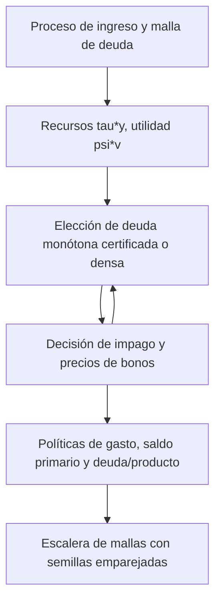

> 🇬🇧 [English](../sovereign_fiscal_rules.md) · 🇪🇸 Español

# Bloque fiscal y reglas fiscales en un modelo de impago soberano

`solve_fiscal_sovereign_default` añade gasto público al modelo de impago
soberano de Arellano (2008) con deuda a corto plazo. Se grava una fracción fija
del producto, el gobierno se endeuda o ahorra con bonos a un período valorados
por prestamistas neutrales al riesgo y gasta el resto. El resultado presenta
las políticas de gasto, saldo primario y deuda sobre producto junto a los
valores, precios y probabilidades de impago habituales.

## Modelo

El producto $y$ sigue el AR(1) de Tauchen de `solve_sovereign_default`,
normalizado a media estacionaria uno. Con tasa impositiva $\tau$, el consumo
privado es $c=(1-\tau)y$ y el gasto público es

$$
g=\tau y-b+q(b',y)\,b'.
$$

El gobierno valora ambos:

$$
V^R(b,y)=\max_{b'}\; u\big((1-\tau)y\big)+\psi\, v(g)+\beta E[V(b',y')\mid y],
$$

$$
V^D(y)=u\big((1-\tau)h(y)\big)+\psi\, v\big(\tau h(y)\big)
+\beta E[\theta V(0,y')+(1-\theta)V^D(y')\mid y],
$$

con $V=\max(V^R,V^D)$ (log-sum-exp si `sigma_eps > 0`), $u$ y $v$ CRRA con
curvaturas `gamma_c` y `gamma_g`, y el producto en impago de Arellano
$h(y)=\min(y,0.969\bar y)$. Los precios son $q(b',y)=E[1-d(b',y')\mid y]/(1+r^*)$.
El saldo primario es $pb=\tau y-g=b-q\,b'$ y la deuda sobre producto, $b'/y$.

El consumo privado no depende de la elección de deuda, de modo que esa
elección es el problema de Arellano con recursos $\tau y$ y utilidad $\psi v$;
el término privado solo desplaza los valores de reembolso e impago y, por
tanto, la decisión de impago y los precios. `private_consumption=False` lo
elimina.

## Unidades

Deuda, gasto y saldo primario se expresan en unidades de **producto medio por
trimestre** (el período del modelo). El producto medio es uno, así que
`debt_to_gdp = 0.02` significa deuda igual al 2 % del producto de un
trimestre. Una razón anual deuda/PIB es **la cuarta parte** de estas cifras
(el 2 % del producto trimestral es el 0,5 % del producto anual). Los
diferenciales están anualizados, `4 * max(0, quarterly_yield - r_star)`.

## Una calibración ilustrativa

`tau` y `psi` no tienen valores por defecto. La llamada siguiente es una
**calibración ilustrativa, no ajustada a ningún dato ni objetivo**:
`tau = 0.20`, `psi = 1`, `gamma_c = gamma_g = 2`, los parámetros públicos de
Arellano (`beta = 0.95282`, `r_star = 0.017`, `theta = 0.282`,
`rho_y = 0.945`, `sigma_y = 0.025`) y la malla pública de deuda escalada por
0,2 (`b_min = -0.03`, `b_max = 0.066`).

```python
from puremacro.sovereign import solve_fiscal_sovereign_default

res = solve_fiscal_sovereign_default(tau=0.2, psi=1.0, n_b=101, n_y=11)
assert res.converged
assert res.metadata["monotone_certification_gap"] <= 1e-11
print(res.summary().tail(5))

path = res.simulate(periods=1000, seed=42)
print(path[["debt_to_gdp", "primary_balance", "g", "spread"]].describe())
```

`res.g_policy`, `res.primary_balance` y `res.debt_to_gdp` son matrices
`(n_b, n_y)` evaluadas en la deuda elegida en cada estado, `res.policy_index`;
`res.g_default` y `res.private_consumption_default` dan los valores en impago.
`res.simulate()` parte de deuda cero y del nodo central de ingreso; sus
columnas incluyen `gdp` (`y` si se reembolsa, $h(y)$ en otro caso), y
`g + private_consumption + primary_balance == gdp`. Su flujo aleatorio difiere
del de `SovereignDefaultResult.simulate` para la misma semilla.
`res.spread_mean`, `res.spread_y_corr` y las filas de diferenciales de
`res.summary()` proceden de la trayectoria de diagnóstico del propio solucionador
(1.500 trimestres, semilla 42, sin calentamiento), por lo que no coincidirán con
los momentos largos con semillas emparejadas de la tabla de mallas.

## Búsqueda y certificación

`policy_search="monotone"` (por defecto) busca la deuda en $O(n_b\log n_b)$
por estado de ingreso, usando la concavidad de $\psi v$. Devuelve los mismos
valores que `"dense"`, y las mismas políticas salvo empates exactos de valor
entre elecciones con distinto ingreso por emisión. Tras converger, una
búsqueda exhaustiva por bloques a los precios devueltos la certifica: una
diferencia superior a `1e-11` produce `RuntimeError`. Si algún gasto candidato
alcanza la barrera de utilidad `1e-6`, la búsqueda monótona produce
`ValueError`; use allí `policy_search="dense"`.
En modo denso esos candidatos quedan excluidos por la barrera
`psi * (-1e12 + 1e6 g)`, cuya fuerza escala con `psi`; se cumplió para `psi`
entre 1e-18 y 1 en una malla de 61 × 7 con `b_max = 0.5`, pero valores de `psi`
inferiores a 1e-12 (una barrera de menos de un útil) no están cubiertos por las pruebas.

## Reducción al solucionador de Arellano

Con `tau=1`, `psi=1`, `gamma_g=gamma` y `private_consumption=False` el modelo
fiscal *es* el de Arellano, y el solucionador reproduce
`solve_sovereign_default` bit a bit (valores, precios, políticas,
diferenciales y número de iteraciones). Esto enlaza el bloque fiscal con el
solucionador validado en la [replicación de Arellano](arellano_replication.md).
Con `tau=0.2`, la malla de deuda escalada por 0,2 y aún
`private_consumption=False`, la homogeneidad CRRA da las mismas políticas,
conjuntos de impago y precios, y valores
$V_\tau=\tau^{1-\gamma}V_1+(\tau^{1-\gamma}-1)/((1-\gamma)(1-\beta))$ (con
$\gamma=1$, $V_1+\log\tau/(1-\beta)$); las pruebas comprueban ambas cosas. La
calibración ilustrativa activa el consumo privado, así que *no* es un modelo
de Arellano reescalado: el término privado cambia la decisión de impago, los
precios y la deuda. Se rechaza `tau=1`
con consumo privado activado (el consumo privado sería cero).

```python
import numpy as np
from puremacro.sovereign import solve_sovereign_default

grid = dict(beta=0.95282, r_star=0.017, theta=0.282, b_min=-0.15, b_max=0.33,
            n_b=101, n_y=9, sigma_eps=0.0, y_penalty_type="arellano",
            enforce_monotonicity=False, tol=1e-10, max_iter=10000,
            policy_search="monotone")
fiscal = solve_fiscal_sovereign_default(tau=1.0, psi=1.0, private_consumption=False, **grid)
plain = solve_sovereign_default(gamma=2.0, **grid)
assert np.array_equal(fiscal.bond_price, plain.bond_price)
assert np.array_equal(fiscal.policy_b, plain.policy_b)
```

## Convergencia en la malla

No existe una referencia fiscal independiente. La escalera de mallas resuelve
el solucionador público con la calibración ilustrativa y la búsqueda monótona
certificada en `n_b` = 1.601, 3.201, 6.401 y `n_y` = 321, 641, y simula
dieciséis semillas emparejadas (1979-1994) de 500.000 trimestres tras 1.000
trimestres de calentamiento. Las tolerancias se fijan antes de resolver: 0,10
para momentos en porcentaje y 0,02 para la correlación, aplicadas al cambio
medio emparejado más su semiamplitud t de Student al 95 % para el último
refinamiento de deuda (3.201 → 6.401 con 641 estados de ingreso) y el último
refinamiento de ingreso (321 → 641 con 6.401 nodos de deuda).

Media de las dieciséis semillas. Deuda/producto en porcentaje del producto trimestral; gasto/producto en porcentaje; diferenciales en porcentaje anual.

| Malla (deuda × ingreso) | Deuda/producto (%) | Diferencial medio (%) | Impago anual (%) | DE del diferencial (pp) | Gasto/producto (%) | corr(pb/y, log y) |
|---|---:|---:|---:|---:|---:|---:|
| 1.601 × 321 | 0,838 | 3,129 | 3,010 | 2,865 | 19,983 | -0,138 |
| 3.201 × 321 | 0,839 | 3,143 | 3,031 | 2,808 | 19,983 | -0,138 |
| 6.401 × 321 | 0,839 | 3,146 | 3,030 | 2,784 | 19,983 | -0,138 |
| 1.601 × 641 | 0,829 | 3,097 | 2,977 | 2,797 | 19,983 | -0,138 |
| 3.201 × 641 | 0,830 | 3,100 | 2,985 | 2,735 | 19,983 | -0,138 |
| 6.401 × 641 | 0,831 | 3,102 | 2,987 | 2,716 | 19,983 | -0,138 |

Veredicto: **superada**. En ambos refinamientos finales, el cambio emparejado de cada
momento más su semiamplitud al 95 % cabe en su tolerancia; el mayor es la desviación
típica del diferencial en el refinamiento de ingreso, 0,070 pp frente a 0,10.
Todas las resoluciones convergieron con diferencia de certificación 0 y ningún
período de reembolso eligió el nodo superior de deuda.
Superar la prueba no significa que no quede deriva: con 6.401 nodos de deuda la
desviación típica del diferencial aún baja de 321 a 641 estados de ingreso
(2,784 → 2,716 pp), y la escalera no tiene un peldaño de 1.281 estados que muestre
dónde se estabiliza. Su tercer dígito merece la misma cautela que la
[guía de Arellano](arellano_replication.md) aplica a los refinamientos de ingreso.
La deuda es baja, cerca del 0,83 % del producto trimestral (en torno al 0,2 %
del producto anual), por la razón anterior: la elección de deuda escala con los
recursos `tau*y`, de modo que el gobierno mantiene unas `tau` veces la deuda del
propio modelo de Arellano, y los modelos de Arellano con deuda a corto plazo ya
mantienen poca deuda. Medido con el mismo motor de trayectorias en mallas de
801 × 161 (8 semillas × 100.000 trimestres), el modelo de Arellano con la
calibración pública (`tau=1`, sin consumo privado) mantiene el 3,64 % del
producto trimestral; `tau=0.2` sin consumo privado, el 0,727 %, exactamente un
quinto; activar el consumo privado lo eleva al 0,86 % (0,83 % en la malla más
fina de la tabla). Eso equivale a cerca del 4 % del ingreso tributario de un
trimestre (`tau` por el producto medio, 0,2).

```sh
MPLBACKEND=Agg python -m tools.reference_validation.check_fiscal_grids --output /tmp/fiscal-grids
```

El registro congelado es `tests/fixtures/sovereign_fiscal/fiscal_grid_convergence.json`;
las pruebas recalculan su veredicto a partir de los momentos por semilla.

## Reglas fiscales

`rule=FiscalRule(...)` restringe la deuda siguiente cuando se reembolsa. Los
prestamistas conocen la regla, de modo que cambia los precios de equilibrio de
los bonos además de las decisiones del gobierno.

| Campo | Significado | Búsqueda |
|---|---|---|
| `debt_ceiling` | tope estricto `b' <= debt_ceiling` | `"monotone"` (certificada), `"exhaustive"`, `"dense"` |
| `escape_below` | toda la regla se suspende cuando `y < escape_below` | la de la regla que suspende |
| `penalty` | todos los componentes pasan a ser blandos: cada uno incumplido cuesta `penalty` útiles (los incumplimientos se suman) | como arriba |
| `deficit_limit` | `b' - b <= deficit_limit` (nuevo endeudamiento neto; negativo exige reducir deuda) | solo `"exhaustive"` o `"dense"` |

Los umbrales están en producto medio por trimestre, como la deuda: un tope de
0,02 es el 2 % del producto de un trimestre, o el 0,5 % del producto anual;
`escape_below=0.92` es un ingreso un 8 % inferior a su media (cerca de una
desviación típica incondicional). Una elección en el tope, con tolerancia
`1e-12`, cumple la regla. Un límite de déficit liga la elección a la deuda
actual, lo que rompe la búsqueda monótona, así que con
`policy_search="monotone"` produce `ValueError`; la búsqueda exhaustiva por
bloques cuesta O(n_b² n_y) por iteración, por lo que conviene usar mallas
gruesas como 401 × 21.

Si una regla estricta deja un estado sin deuda admisible (por ejemplo
`deficit_limit=-0.01` en los nodos de deuda más bajos), el solucionador falla
antes de resolver y nombra hasta diez de esos estados; con
`infeasible="default"` el gobierno incurre en impago seguro en ellos
(`v_repay = -inf`, `default_prob = 1`).

```python
from puremacro.sovereign import FiscalRule, solve_fiscal_sovereign_default

small = dict(tau=0.2, psi=1.0, n_b=101, n_y=11)
rules = {
    "ceiling": FiscalRule(debt_ceiling=0.02),
    "ceiling_escape": FiscalRule(debt_ceiling=0.02, escape_below=0.92),
    "soft_ceiling": FiscalRule(debt_ceiling=0.02, penalty=0.05),
    "deficit": FiscalRule(deficit_limit=0.005),
}
for name, rule in rules.items():
    search = "exhaustive" if rule.deficit_limit is not None else "monotone"
    res = solve_fiscal_sovereign_default(**small, rule=rule, policy_search=search)
    assert res.converged and res.rule is rule
    print(name, res.metadata["policy_search"], round(float(res.policy_b.max()), 4))

strict = FiscalRule(deficit_limit=-0.01)          # must cut debt by 1% of output each quarter
try:
    solve_fiscal_sovereign_default(**small, rule=strict, policy_search="exhaustive")
except ValueError as err:
    print(err)                                     # names the states with no admissible choice
forced = solve_fiscal_sovereign_default(
    **small, rule=FiscalRule(deficit_limit=-0.01, infeasible="default"), policy_search="exhaustive")
print(forced.metadata["rule_infeasible_states"])  # those states now default for sure
```

### Predicciones registradas y resultado

Antes de resolver ninguna regla se registraron las predicciones siguientes y
sus definiciones en `tests/fixtures/sovereign_fiscal/rule_predictions_protocol.json`;
`tools/reference_validation/check_fiscal_rule_predictions.py` las midió
(registro: `rule_predictions_record.json`; 16 semillas emparejadas × 100.000
trimestres). Las fracciones de activación se miden en las trayectorias **sin
regla**: la fracción de trimestres de reembolso en que la elección sin
restricción incumpliría la regla.

| Predicción | Registrada | Resultado | Veredicto |
|---|---|---|---|
| Cláusula de escape inerte: mayor deuda elegida con `y < 0.92` | cerca de 0,001, muy por debajo de 0,02 | 0,00048 (401 × 21), 0,00060 (801 × 41); ningún momento cambia | se cumplió |
| El tope de 0,02 se activa | 19–23 % de los trimestres de reembolso | 23,4 % | **no se cumplió** |
| El tope solo se activa en auges (`y > 1`) | todos los trimestres activos | todos | se cumplió |
| El límite de déficit de 0,005 se activa | 1–2 % | 1,7 % | se cumplió |
| Equivalente en producto de `penalty=0.05` | cerca de 0,002 | 0,0020 | se informa (sin banda registrada) |

La fracción de activación del tope quedó justo por encima de la banda
registrada; se informa tal cual, y ningún umbral se cambió después.
En la fila de la cláusula de escape, «se cumplió» es el criterio de la
herramienta: la mayor deuda elegida con `y < 0.92` queda por debajo del tope de
0,02 en ambas mallas, y todos los momentos superan la comparación emparejada con
el tope simple. Los valores hallados, 0,00048 y 0,00060, son cerca de la mitad
del «cerca de 0,001» del protocolo.

**Por qué la cláusula de escape no hace nada aquí.** El riesgo de impago es
máximo en las malas épocas, así que los precios de los prestamistas ya
encarecen el endeudamiento en recesión: con ingreso inferior a 0,92 el gobierno
sin restricción nunca elige más de 0,00048 del producto trimestral, la
cuadragésima parte del tope. Con esos ingresos el precio del bono en el tope es
prácticamente cero (como mucho el 0,13 % del precio sin riesgo), y lo máximo que
el gobierno puede obtener endeudándose es 0,0011 del producto trimestral
(401 × 21). La disciplina de mercado actúa antes que la regla, de modo que suspenderla en recesión no cambia nada: las filas con
cláusula de escape coinciden con el tope simple en todas las semillas. El tope
solo se activa en auges, cuando el gobierno se endeudaría más.

**Escala de la penalización.** La penalización está en útiles. Dividida por la
utilidad marginal del gasto, `psi g^(-gamma_g)`, promediada en los trimestres
de reembolso del modelo con tope blando (`g` medio = 0,200), da su
equivalente en producto: `penalty=0.05` cuesta cerca de 0,0020 del producto
trimestral por incumplimiento. En las trayectorias simuladas, que parten de
deuda cero, el gobierno nunca supera el tope a ese precio (0,0 % de los
trimestres de reembolso), y con cualquier deuda actual `b <= 0.02` las reglas
blanda y estricta eligen la misma deuda. Fuera de esas trayectorias difieren:
en 503 estados de reembolso, todos con deuda actual de al menos 0,04776, el
gobierno con regla blanda refinancia su deuda por encima del tope y paga la
penalización en lugar de recortar de golpe hasta el tope. Las trayectorias que
parten de deuda alta, como los gráficos de abanico de sostenibilidad, mostrarían
esa diferencia.

**MALLA GRUESA 401 × 21: compare reglas solo dentro de esta tabla.** Los
momentos en malla gruesa difieren de los convergidos (la DE del diferencial sin
regla es aquí 5,906 pp frente a 2,716 con 6.401 × 641).

| Regla | Deuda/producto (%) | Diferencial medio (%) | Impago anual (%) | DE del diferencial (pp) |
|---|---:|---:|---:|---:|
| `none` | 1,057 | 3,912 | 3,744 | 5,906 |
| `ceiling` | 0,796 | 3,726 | 3,569 | 5,698 |
| `ceiling_escape` | 0,796 | 3,726 | 3,569 | 5,698 |
| `soft_ceiling` | 0,796 | 3,726 | 3,569 | 5,698 |
| `deficit` | 1,053 | 3,908 | 3,739 | 5,902 |

El tope reduce la deuda media, y la menor deuda va acompañada de diferenciales y
frecuencia de impago más bajos; el límite de déficit apenas se activa.

## Límites

- Economía de dotación: el producto no responde a impuestos ni al gasto.
- Tasa impositiva fija: `tau` es un parámetro, no una decisión de política.
- Solo deuda a corto plazo (`delta = 1`, `kappa = 0`).
- Las reglas son plenamente creíbles y permanentes; el gobierno no puede renegociarlas.
- La calibración es ilustrativa y los momentos describen este modelo con
  estos parámetros, no a ningún país.


