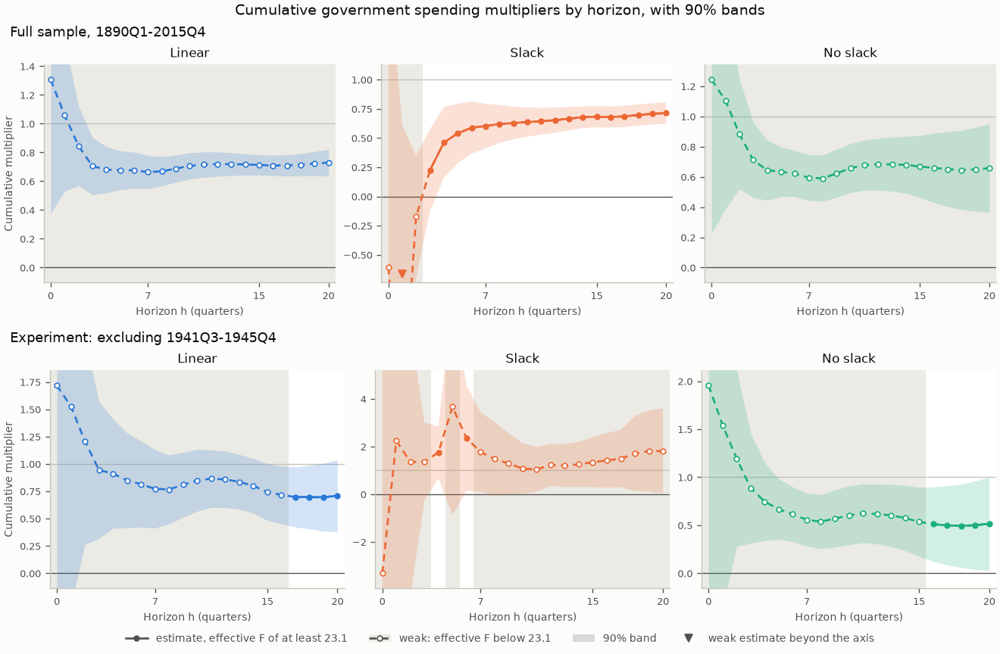

> 🇬🇧 English · 🇪🇸 [Español](es/first_brief_fiscal.md)

# Your first fiscal brief: the spending multiplier, with and without slack

This page walks through one complete fiscal policy question on public data.
When the US government buys an extra dollar of goods and services, how much
does GDP rise over two and four years, and is the answer different when the
economy has slack? The brief estimates the one-step local projections of
Ramey and Zubairy (2018) on their quarterly US data for 1890-2015, which ship
with puremacro, with military spending news as the instrument. It reports
which of its numbers the instrument can support, repeats the estimates
without World War II, shows the two calls that run on your own data, and
states what the numbers do not say. Nothing needs to be downloaded besides
the package.

## 1. Install

You need Python 3.11 or later. The brief, and the `cumulative=True` option of
the local projections it uses, are new after puremacro 6.1.0 (see the
Unreleased section of the changelog). You need a release that includes them,
or a source checkout:

```bash
python -m pip install puremacro    # a release after 6.1.0
python -m pip install .            # or, from a source checkout
```

## 2. Run

One command runs the brief and writes its tables, figure and record:

```bash
python -m puremacro.examples.first_brief_fiscal --output fiscal_brief
```

The same run from Python:

```python
from puremacro.examples.first_brief_fiscal import run_brief, summary_text

study = run_brief("fiscal_brief")
print(summary_text(study["record"]))
```

The output directory holds `headline.{md,csv,tex}` (the tables and readings
below), `paths.csv` (every horizon from 0 to 20), `multipliers.png`,
`headline.json` (the record behind this page) and `manifest.json` (package
and library versions, the data file's citation and SHA-256, the
specification, warnings, timings and the environment). Options:
`--exclude START:END` adds the experiment of section 4, `--output DIR` sets
the directory (default `fiscal_brief`) and `--lang en|es` the language. With
the experiment, the whole command took about 2.3 s of wall time on an Apple
M3 Pro: 0.5 s to compute the estimates, 0.4 s to write the outputs, and the
rest to start Python and import the packages.

## 3. Preview: the multipliers at two and four years

The multiplier at horizon h is the extra GDP summed over the quarters t to
t+h, per dollar of extra government purchases summed over the same quarters.
Two and four years are h = 7 and h = 15, the 8- and 16-quarter windows of
Ramey and Zubairy's Table 1. Each multiplier is estimated in one step: the
window sum of GDP is regressed on the window sum of purchases, instrumented
by the military news shock (Ramey 2011), with four lags of GDP, purchases
and news as controls. Slack means that the unemployment rate in the previous
quarter was at least 6.5%; with slack and without it, every coefficient is
estimated separately. Bands are 90%, with HAC variances on h + 1 lags.

A cell is weak when its effective F, the strength of the instrument in that
cell, is below 23.1, the cutoff of Montiel Olea and Pflueger (2013) for one
instrument. The conventional band of a weak cell is unreliable, so the brief
shows a weak cell by its weak-instrument-robust Anderson-Rubin (1949) 90% set,
marked †, and never by its point estimate. The table and the reading below
are the frozen output of the default run.

<!-- fiscal-brief:headline -->
| Multiplier | 2 years (h = 7) | Effective F | 4 years (h = 15) | Effective F |
|:---|---:|---:|---:|---:|
| Linear | [0.57, 0.83] † | 16.0 | [0.65, 0.81] † | 12.0 |
| Slack | 0.60 [0.41, 0.79] | 210.2 | 0.68 [0.59, 0.77] | 105.8 |
| No slack | [0.44, 0.82] † | 7.3 | [0.40, 0.89] † | 10.8 |
| Slack minus no slack | not reliable |  | not reliable |  |

Estimate [90% band]. The difference is reported only where neither regime is weak. † effective F below 23.1: the Anderson-Rubin set is shown instead of the estimate.
<!-- /fiscal-brief:headline -->



In the figure, solid lines and filled dots mark the horizons where the
instrument clears the cutoff. Dashed lines, hollow dots and grey shading mark
the weak horizons: there the line is drawn for reference only, and the
Anderson-Rubin set is the number to quote. The top row is the full sample;
the bottom row is the experiment of section 4.

<!-- fiscal-brief:headline_reading -->
Multipliers are dollars of GDP per dollar of government purchases, both cumulated over the horizon. Linear: weak at 2 years (effective F 16.0, cutoff 23.1), with a weak-instrument-robust 90% set of 0.57 to 0.83; weak at 4 years (effective F 12.0, cutoff 23.1), with a weak-instrument-robust 90% set of 0.65 to 0.81. Slack: 0.60 at 2 years (90% band 0.41 to 0.79); 0.68 at 4 years (90% band 0.59 to 0.77). No slack: weak at 2 years (effective F 7.3, cutoff 23.1), with a weak-instrument-robust 90% set of 0.44 to 0.82; weak at 4 years (effective F 10.8, cutoff 23.1), with a weak-instrument-robust 90% set of 0.40 to 0.89. The comparison of the multipliers with and without slack is not reliable at either horizon, because at least one regime is weak at each. Slack: one quarter, 1941Q4, carries 52% of the instrument's residual variation at both horizons. No slack: one quarter, 1950Q3, carries 36% of the instrument's residual variation at both horizons.
<!-- /fiscal-brief:headline_reading -->

Read it this way: in the full sample, every band and every robust set lies
between 0 and 1, with slack and without. At 90%, the data rule out both a
multiplier of zero and a multiplier of one at two and four years: an extra
dollar of purchases came with less than a dollar of extra GDP, so the rest of
GDP (private spending and net exports) fell as purchases rose. The
instrument is strong only with slack, from h = 3 on. In the linear model and
without slack it stays below the cutoff at every horizon, so the brief
cannot test whether slack changes the multiplier. With slack, one quarter,
1941Q4, when the United States entered World War II, carries about half of
the instrument's residual variation, which is why the next section removes
the war.

## 4. One experiment: without World War II

```bash
python -m puremacro.examples.first_brief_fiscal --exclude 1941Q3:1945Q4 --output fiscal_brief_no_war
```

World War II is the largest spending episode in the data, and its news
includes the largest shock in the sample, in 1941Q4. Ramey and Zubairy (2018,
p. 867) exclude 1941Q3-1945Q4: "we exclude observations when either the
dependent variable, the shock, or the lagged control variables occur in the
period". The brief applies the same rule. GDP, purchases and news become
missing in the period, every row is kept, the lag controls are rebuilt from
the masked series, and the window sums carry the gap. A quarter therefore
drops when its window, its shock or one of its lags touches the war: at
h = 7, every quarter from 1939Q4 to 1946Q4. Both quarters named in
`--exclude` are excluded.

Beside each regime's numbers, the reading reports a concentration
diagnostic. On the rows a regime uses at a headline horizon, the news shock
is regressed on a constant and the controls. The diagnostic is the largest
single quarter's share of the squared residuals, with its date, and it is
reported when the share is at least 25%. With normally distributed
residuals and regime samples of these sizes (153 to 313 quarters), the
largest quarter carries more than 10% in fewer than one sample in a hundred.
A share of 25% or more therefore means that one episode carries much of the
variation that identifies the regime's multiplier.

<!-- fiscal-brief:experiment -->
| Multiplier | 2 years (h = 7) | Effective F | 4 years (h = 15) | Effective F |
|:---|---:|---:|---:|---:|
| Linear | [0.54, 2.04] † | 4.8 | [0.50, 1.07] † | 19.6 |
| Slack | [0.07, 3.61] † | 20.8 | (-∞, -55.98] ∪ [0.56, ∞) † | 3.2 |
| No slack | [0.25, 1.00] † | 5.7 | [0.18, 0.90] † | 22.3 |
| Slack minus no slack | not reliable |  | not reliable |  |

Estimate [90% band]. The difference is reported only where neither regime is weak. † effective F below 23.1: the Anderson-Rubin set is shown instead of the estimate.
<!-- /fiscal-brief:experiment -->

<!-- fiscal-brief:experiment_reading -->
Excluding 1941Q3-1945Q4: every quarter whose window, shock or lags touch the period is dropped, as Ramey and Zubairy do for World War II. Multipliers are dollars of GDP per dollar of government purchases, both cumulated over the horizon. Linear: weak at 2 years (effective F 4.8, cutoff 23.1), with a weak-instrument-robust 90% set of 0.54 to 2.04; weak at 4 years (effective F 19.6, cutoff 23.1), with a weak-instrument-robust 90% set of 0.50 to 1.07. Slack: weak at 2 years (effective F 20.8, cutoff 23.1), with a weak-instrument-robust 90% set of 0.07 to 3.61; weak at 4 years (effective F 3.2, cutoff 23.1), and its weak-instrument-robust 90% set is unbounded: the data cannot bound it. No slack: weak at 2 years (effective F 5.7, cutoff 23.1), with a weak-instrument-robust 90% set of 0.25 to 1.00; weak at 4 years (effective F 22.3, cutoff 23.1), with a weak-instrument-robust 90% set of 0.18 to 0.90. The comparison of the multipliers with and without slack is not reliable at either horizon, because at least one regime is weak at each. Slack: one quarter, 1961Q2, carries 41% of the instrument's residual variation at 2 years and 48% at 4 years. No slack: one quarter, 1950Q3, carries 49% of the instrument's residual variation at both horizons. No estimate clears the cutoff in this sample, so none is compared with the full sample. Ramey and Zubairy's Table 3 values without World War II are three-step estimates (summed impulse responses); the brief's are one-step, so the two need not match.
<!-- /fiscal-brief:experiment_reading -->

Read it this way: without the war, no cell clears the cutoff, so every
number in the table is a weak-instrument-robust set, and most sets are much
wider than in the full sample. With slack at four years, the data cannot
bound the multiplier at all. Ramey and Zubairy (2018, p. 876) also find that
without the war all their instrument sets appear weak in the
high-unemployment state beyond two years. These sets cannot show that the
multiplier is larger with slack once the war is excluded, and the
identification again leans on single episodes: 1961Q2 with slack and 1950Q3,
the start of the Korean War, without slack.

## 5. Your own data

The brief is two calls to puremacro's local projections with
`cumulative=True`. The block below makes them on the bundled data exactly as
you would on your own quarterly frame: replace `df` with yours. It also
excludes a period by Ramey and Zubairy's rule.

```python
from puremacro.examples.ramey_zubairy_2018_multipliers import RZ_CONTROLS, load_rz_data
from puremacro.lp import lp_iv, lp_state_dep_iv

df = load_rz_data()        # quarterly, 1890Q1-2015Q4, every row kept

# Excluding a period by Ramey and Zubairy's rule: y, g and the instrument become
# NaN in 1941Q3-1945Q4, the rows stay, and every lag column is rebuilt.
no_war = df.drop(columns=["cumy", "cumg"])    # running sums summed before the masking
quarter = no_war.index.to_period("Q")
no_war.loc[(quarter >= "1941Q3") & (quarter <= "1945Q4"), ["y", "g", "newsy"]] = float("nan")
for name in RZ_CONTROLS:                      # "g_l2" is g two quarters earlier
    series, lag = name.rsplit("_l", 1)
    no_war[name] = no_war[series].shift(int(lag))

for label, frame in (("Full sample", df), ("Without 1941Q3-1945Q4", no_war)):
    linear = lp_iv(frame, y="y", x="g", z="newsy", horizons=[7, 15], n_lags=0,
                   controls=RZ_CONTROLS, cumulative=True, anderson_rubin=True)
    state = lp_state_dep_iv(frame, y="y", x="g", z="newsy", state="slack_l",
                            horizons=[7, 15], n_lags=0, controls=RZ_CONTROLS,
                            transition="threshold", threshold=0.5, cumulative=True)
    # A cell is weak when its effective F (mop_f; first_stage_f_H and first_stage_f_L
    # by regime) is below mop_cv_10: quote its Anderson-Rubin set, not its beta.
    print(label)
    print(linear[["mop_f", "mop_cv_10", "beta", "lo", "hi", "ar_lo", "ar_hi", "ar_set_type"]].round(2))
    print(state[["first_stage_f_H", "beta_H", "lo_H", "hi_H",
                 "first_stage_f_L", "beta_L", "lo_L", "hi_L"]].round(2))
```

What your frame needs, and what the calls assume:

- **A regular quarterly index, with every row kept.** Window sums need
  consecutive quarters, so `cumulative=True` rejects a date or period index
  with a gap. Do not drop rows with missing values: at each horizon the
  estimators skip the rows whose window, instrument, state or controls are
  missing.
- **Gordon-Krenn scaling.** `y` and `g` are real GDP and real government
  purchases, both divided by the same trend estimate of potential real GDP
  (Gordon and Krenn 2010); Ramey and Zubairy fit a sixth-degree polynomial to
  log real GDP, leaving out 1930-1946. In common units the coefficient is
  directly dollars of GDP per dollar of purchases. With logs it would be an
  elasticity that needs a conversion factor, the sample average of GDP over
  purchases, and Ramey and Zubairy show that, in their long sample, this
  conversion biases the multiplier upward. The news shock is scaled the same
  way: nominal news divided by the previous quarter's nominal potential GDP
  (the GDP deflator times potential real GDP).
- **Controls.** `n_lags=0` with the explicit lag columns in `RZ_CONTROLS`
  (four lags of `y`, `g` and `newsy`) reproduces Ramey and Zubairy's
  controls. Keep the first lag of `y` (`y_l1`) among them: the coefficient
  then equals their sum-of-GDP form (see [Local Projections](lp.md),
  "Cumulative multipliers").
- **What the instrument must satisfy.** It must be relevant: it moves
  purchases over the window. Check the effective F at each horizon (`mop_f`),
  and by regime (`first_stage_f_H`, `first_stage_f_L`); below `mop_cv_10`
  (23.1 for one instrument) the band is unreliable and the Anderson-Rubin set
  is the number to quote. It must be exogenous: unrelated to the other forces
  that move GDP, at the date of the shock and before and after it, once the
  controls are included. Relevance can be measured; exogeneity cannot, and
  it is argued from how the series is built. Military news records changes
  in expected defense spending driven by political and military events
  (Ramey 2011).
- **Dating the state at t-1.** Each quarter is sorted by the state of the
  economy before the shock: `slack_l` is 1 when the unemployment rate in the
  previous quarter was at least 6.5%. From your own rate,
  `(df["unemp"] >= 6.5).astype(float).where(df["unemp"].notna()).shift(1)`
  keeps a missing rate missing instead of reading it as "no slack". The state
  is a 0/1 indicator, so `threshold=0.5` splits it, and every coefficient is
  regime-specific by default (`interact="all"`).
- **Excluding a period.** As in the block: set `y`, `g` and the instrument to
  NaN in the period, keep the rows and rebuild every lag column from the
  masked series. Never reuse running sums computed before the masking
  (`cumy` and `cumg` in the bundled frame). A quarter then drops at horizon h
  when its window, its shock or one of its lags touches the period.
- **A regime's Anderson-Rubin set.** `lp_state_dep_iv` reports bands and F by
  regime but no Anderson-Rubin set. The brief takes each regime's set from
  `lp_iv(..., anderson_rubin=True)` on a frame whose instrument is NaN outside
  the regime, for example
  `frame.assign(newsy=frame["newsy"].where(frame["slack_l"] == 0))` for no
  slack (see section 6).
- **Without a narrative shock: the Blanchard-Perotti route.** If no news
  series exists for your economy, the usual alternative follows Blanchard and
  Perotti (2002): the part of current purchases that the lagged controls do
  not predict is treated as a shock. Regress `g` on a constant and the lags
  of `y` and `g`, and pass the residual as `z`, with no news lags among the
  controls. This adds an assumption the news series does not need: purchases
  do not respond to the economy within the quarter, because budgets take time
  to decide and carry out. Its weak point is anticipation: Ramey (2011) shows
  that military spending is often known quarters before it is spent. Ramey
  and Zubairy find this shock relevant at short horizons and often weak
  beyond a year or two.

## 6. Assumptions and limits

- **US historical data dominated by wars.** The sample is 1890-2015, and the
  largest news shocks come from World War I, World War II and the Korean War.
  The multipliers are driven by those episodes and by the defense purchases
  that followed the news; carrying them to other spending, another country or
  today is an assumption.
- **Instrument relevance and exogeneity.** Relevance is measured, horizon by
  horizon and regime by regime, by the effective F. Exogeneity is assumed:
  military news must move GDP only through purchases. Wartime rationing,
  capacity constraints, conscription or taxes announced with the same news
  would break it; Ramey and Zubairy exclude World War II to check whether
  rationing and capacity constraints drive their results.
- **Weak instruments by horizon and regime.** In the full sample the
  instrument is strong only with slack, from h = 3 on; without World War II
  it is weak in every headline cell. A weak cell is reported by its
  Anderson-Rubin set, whose coverage does not depend on the strength of the
  instrument, at the price of width; an unbounded set means that the data
  cannot bound the multiplier. Ramey and Zubairy's Figure 4 (p. 868) shows
  the same pattern for military news in the full sample: below the threshold
  at every horizon in the linear model and with low unemployment, and above
  it with high unemployment after the first quarters.
- **State timing.** The state is dated before the shock (unemployment at
  t-1), so the shock cannot move the state that sorts it. The state still
  depends on earlier shocks. Gonçalves, Herrera, Kilian and Pesavento (2024)
  show that, when the state depends on macroeconomic shocks, state-dependent
  local projections recover only the conditional response to an
  infinitesimal shock, not the response to larger shocks; in their
  simulations fiscal multipliers may be off by as much as 40 percent. The
  news shocks behind the slack regime include the largest in the sample, so
  read the regime multipliers as responses to small changes in purchases.
- **The regime Anderson-Rubin sets are an approximation.** They come from
  per-regime masked regressions: `lp_iv` with the instrument set to missing
  outside the regime. The estimates are identical to the regime's, but the
  HAC sums treat a regime's non-adjacent quarters as neighbours, so the set
  is close to, not equal to, one from the joint regression.
- **Bandwidth.** Ramey and Zubairy's standard errors use an automatic HAC
  bandwidth (their footnote 17), while the brief uses h + 1 lags for the
  bands, the effective F and the Anderson-Rubin sets alike. So only point
  estimates are compared with their tables: at h = 7 and 15 the brief's
  full-sample estimates match their Table 1 to two decimals.
- **One step, not three.** Ramey and Zubairy's Table 3 values without World
  War II are three-step estimates, summed impulse responses (their footnote
  26), while the brief's are one-step. The two methods agree only when every
  regression uses the same sample (their footnote 14), and the exclusion
  breaks that, so the experiment is not compared with their Table 3.
- **Units.** Multipliers are dollars of GDP per dollar of government
  purchases, both cumulated over the quarters t to t+h: an integral
  multiplier, not the ratio of the peak GDP response to the initial spending
  shock, the definition of Blanchard and Perotti (2002).
- **Not a tax multiplier, not a financing comparison.** The brief measures
  government purchases of goods and services, not transfers or tax changes,
  and it does not separate how the purchases were paid for: wartime spending
  came with taxes, borrowing and rationing in proportions the estimate
  averages over. It says nothing about debt against tax finance.

## 7. Cite

If you publish results computed from the bundled data, cite the paper and the
data:

Ramey, V. A. & Zubairy, S. (2018). Government Spending Multipliers in Good Times and in Bad: Evidence from US Historical Data. Journal of Political Economy, 126(2), 850-901. https://doi.org/10.1086/696277

The data are a frozen snapshot of the quarterly series in Valerie Ramey's
replication archive for that paper (`Ramey_Zubairy_replication_codes.zip`,
on her [research page](https://econweb.ucsd.edu/~vramey/research.html)),
bundled as `puremacro/replication/data/rz2018.csv`; each run's
`manifest.json` records its SHA-256. To cite puremacro itself, use the
metadata in `CITATION.cff` in the repository.

Other works this page relies on:

- Anderson, T. W. & Rubin, H. (1949). Estimation of the Parameters of a Single Equation in a Complete System of Stochastic Equations. The Annals of Mathematical Statistics, 20(1), 46-63. https://doi.org/10.1214/aoms/1177730090
- Blanchard, O. & Perotti, R. (2002). An Empirical Characterization of the Dynamic Effects of Changes in Government Spending and Taxes on Output. The Quarterly Journal of Economics, 117(4), 1329-1368. https://doi.org/10.1162/003355302320935043
- Gonçalves, S., Herrera, A. M., Kilian, L. & Pesavento, E. (2024). State-dependent local projections. Journal of Econometrics, 244(2), 105702. https://doi.org/10.1016/j.jeconom.2024.105702
- Gordon, R. & Krenn, R. (2010). The End of the Great Depression 1939-41: Policy Contributions and Fiscal Multipliers. NBER Working Paper 16380. https://doi.org/10.3386/w16380
- Montiel Olea, J. L. & Pflueger, C. (2013). A Robust Test for Weak Instruments. Journal of Business & Economic Statistics, 31(3), 358-369. https://doi.org/10.1080/00401706.2013.806694
- Ramey, V. A. (2011). Identifying Government Spending Shocks: It's All in the Timing. The Quarterly Journal of Economics, 126(1), 1-50. https://doi.org/10.1093/qje/qjq008
