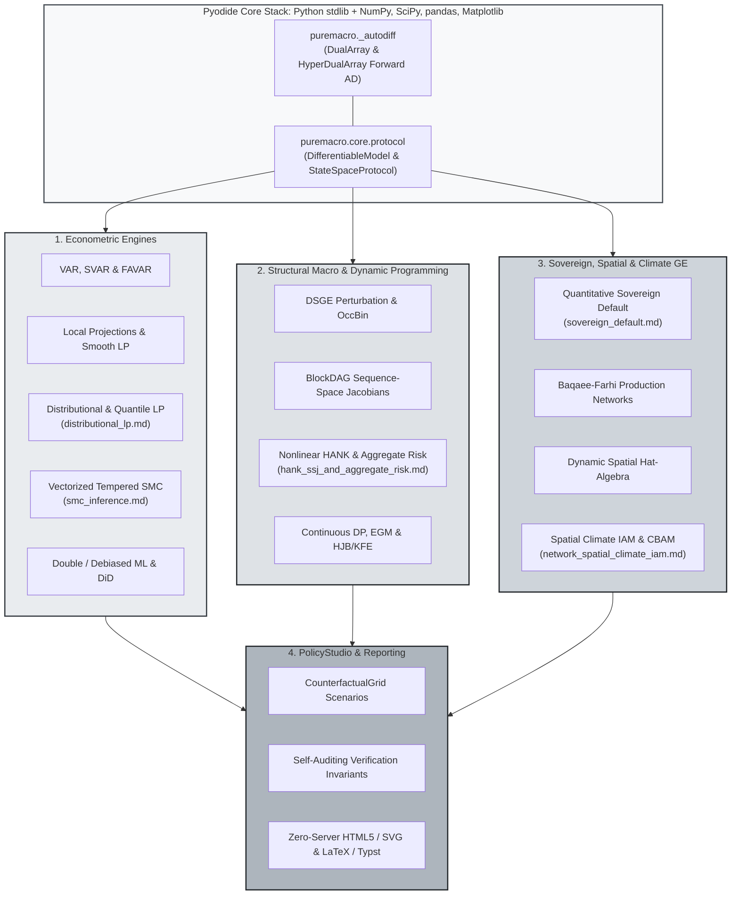

> 🇬🇧 English · 🇪🇸 [Español](es/index.md)

# puremacro

**Macroeconometrics and structural modeling on the core scientific-Python stack.**

[](https://pypi.org/project/puremacro/)
[](https://www.python.org/downloads/)
[](https://jalonso1979.github.io/puremacro/)
[](https://opensource.org/licenses/MIT)

Estimate policy effects, compare economic models, and export results for a
research note or policy brief. Start with Python 3.11 or later:

```bash
python -m pip install puremacro
```

| Start with your task | First steps |
|---|---|
| **Analyze data** | Estimate a government spending multiplier in the [fiscal brief](first_brief_fiscal.md), or a shock response with the [quickstart](quickstart.md); then explore [data sources](micro_data.md) and [research workflows](research_workflows.md). |
| **Simulate policy** | Declare a household model with [dynamic programming](dp.md), study [monetary transmission](monetary_transmission.md), or build a [trade counterfactual](trade_accounting.md). |
| **Write a policy brief** | Run a [tariff experiment on public data](first_brief_tariffs.md) and read national and household welfare effects. |
| **Learn or teach** | Choose a [notebook learning path](notebooks.md) or use the [bilingual course and interactive labs](https://github.com/jalonso1979/puremacro/tree/main/curso). Use the pinned course edition below. |

**Version guide:** this source and its documentation target **6.4.0**. See [PyPI](https://pypi.org/project/puremacro/) for published versions and match the documentation to your installed version.
See the [recommended tests and next milestones](research_reliability.md).
In 6.4.0, the [fiscal brief](first_brief_fiscal.md) accepts own-data quarterly datasets, [connector freshness reporting](CONNECTOR_HEALTH.md) audits bounded provenance and revisions, [local projections](lp.md) enforce chronological and specification contracts with two-way fixed-effects panel IV, and numerical/data defects are corrected (see [correctness advisories](ADVISORY.md)).
Since 6.3.0, the [research APIs](research_api.md) add equilibrium derivatives and continuation, simulation-aware SMM and identification-robust inference, alongside [experimental second-order HANK](hank_second_order.md).

Available since 6.0.1 (introduced in the 6.0.0 source tag): [Forward AD & Differentiable Model Protocol](autodiff_and_protocol.md), [Vectorized Tempered SMC](smc_inference.md), [Nonlinear HANK & 2nd-Order Aggregate Risk](hank_ssj_and_aggregate_risk.md), [Quantitative Sovereign Default](sovereign_default.md), [Distributional Local Projections](distributional_lp.md), and [Production Networks, Spatial Climate IAM & PolicyStudio](network_spatial_climate_iam.md).

Also included from previous cycles: [DSGE workflows and method selection](dsge_workflows.md), [nonlinear models](dsge_nonlinear.md), [transitions and announcements](dsge_transitions.md), and [local/global accuracy](dsge_global.md). Review the [experimental inference limits](dependence_bootstrap.md) and [audits of supported solved results](result_audits.md). Users of `STEADY_STATE()` in nonlinear trajectories should review the [correctness advisory](ADVISORY.md) and re-run affected calculations.

The bilingual [course edition `course-2026A-5.5.0`](https://github.com/jalonso1979/puremacro/blob/course-2026A-5.5.0/curso/notebooks/README.md)
pins `puremacro==5.5.0` and requires **Python 3.12 or later**. All 72 notebooks
were executed against the [recorded candidate wheel](https://github.com/jalonso1979/puremacro/blob/course-2026A-5.5.0/curso/validation/README.md)
with frozen data and cached language-model responses, including the required
DP and text sections. The [release record](https://github.com/jalonso1979/puremacro/releases/tag/v5.5.0)
verifies that the published wheel contains the same runtime files. Live data refreshes and live local models
remain optional and were not part of that validation. Follow the edition's
setup instructions; the library itself continues to support Python 3.11+.

## What is puremacro?

`puremacro` brings econometric estimators and quantitative macroeconomic models
together using NumPy, SciPy, pandas and Matplotlib, with no compiled extension of
its own. A local workstation installation is the supported target. The numerical
core also runs under Pyodide / WebAssembly; browser and tablet workflows remain
best effort, with limits on file formats, network access and computation. See the
[runtime guide](tablet.md) and the [structural validation status](STRUCTURAL_VALIDATION_STATUS.md)
for the scope of the evidence.



### Key Subsystems

1. **Structural DSGE & Dynare Parity**:
   - **Native Dynare `.mod` Parser & `puremacro-dynare` CLI**: Inspect command support, then parse and solve the supported `.mod` subset in pure Python ([Inspection and limits](dsge_mod_inspection.md)).
   - **Likelihood Scores**: An analytic Kalman recursion for structural parameters in the supported first-order stationary likelihood; structural derivative inputs may use finite differences. NUTS also offers numerical and user-supplied gradients; the estimation interface determines gradient selection and fallback ([Guide](dsge_estimation.md)).
   - **Pure-Python HMC & NUTS**: Hamiltonian Monte Carlo with dual-averaging step-size adaptation, diagonal mass adaptation, and split-$\hat{R}$ diagnostics without rank normalization.
   - **Optimal Discretionary Policy vs Commitment**: Dennis (2007) Riccati matrix iterations for Markov-perfect discretionary policy vs timeless-perspective commitment, decomposing inflation and stabilization biases.
   - **DSGE-VAR Hybrid Modeling**: Del Negro & Schorfheide (2004) DSGE-VAR($\lambda$) prior optimization and structural identification.
   - **Anticipated News Shocks**: State-space companion augmentation with nilpotent shift operators preserving Blanchard-Kahn determinacy.
   - **Nonlinear Particle Filtering & MS-DSGE**: Bootstrap and auxiliary particle filters with stochastic volatility, and Foerster et al. (2016) Markov-switching rational expectations solutions with closed-form analytical GIRFs.
   - **Perturbation and Occasionally Binding Constraints**: Pruned perturbation for unconstrained models and piecewise-linear OccBin for binding regimes ([Guide](dsge_build.md)). `solve_pruned_occbin` supports linear OccBin, including anticipated shocks, and slack second-order paths with one initial innovation; nonlinear binding episodes and nonlinear anticipated innovations raise explicit errors ([Supported limits](dsge_higher_order.md)).

2. **Heterogeneous-Agent Models (Declarative DP & HANK)**:
   - **Household Models as Equations**: Declare states, choices, rewards and constraints with `dp.Model`, then select VFI, EGM, continuous-time HJB or a supported Krusell–Smith solve ([Guide](dp.md)).
   - **Sequence-Space HANK** (Auclert, Bardóczy, Rognlie & Straub 2021, *Econometrica*): General equilibrium incomplete-markets models solved in $\mathcal{O}(T^3)$ sequence space.
   - **Fake News Algorithm**: Fast $\mathcal{O}(T^2)$ computation of sequence-space consumption Jacobians via expectation vectors and cumulation identities.
   - **HANK Sequence-Space Bridge**: Declare `hetagent_block` directly inside standard Dynare `.mod` files.
   - **Targeted Fiscal Transfers**: Dynamic consumption IRFs and cumulative fiscal multipliers across wealth deciles.
   - **Continuous-Time HJB**: Achdou et al. (2022) **implicit** upwind finite-difference M-matrix schemes, the adjoint Kolmogorov forward equation for the stationary density, and continuous-time Aiyagari general equilibrium.
   - **Nonlinear HANK Transitions & 2nd-Order Aggregate Risk**: Composable `BlockDAG` general equilibrium sequence-space Jacobians, nonlinear transitions with Good Broyden updates, and a reduced aggregate-risk algebra demonstration with prescribed moments ([Guide](hank_ssj_and_aggregate_risk.md)).

3. **Econometric Engines & Local Projections**:
   - **Unified `LPResult`**: Standardized Local Projections (`lp_hac`, `lp_iv`, `lp_state_dep`, `panel_lp`) with Newey-West HAC, fixed-$b$, and Driscoll-Kraay standard errors.
   - **Distributional & Quantile Local Projections**: Cross-sectional share and quantile impulse response functions strictly satisfying exact adding-up ($\sum \beta_b = 0$) with Driscoll–Kraay covariance and direct structural bridging to `HetBlock` HANK models ([Guide](distributional_lp.md)).
   - **Vectorized Tempered Sequential Monte Carlo (SMC)**: Adaptive $\phi_n$ tempering schedules, analytical score-guided Langevin/Hamiltonian mutations, and log marginal data density ($\ln p(Y)$) estimation ([Guide](smc_inference.md)).
   - **Structural VARs & FAVAR**: Cholesky, Blanchard-Quah, Sign Restrictions, Narrative Sign Restrictions, Proxy/External Instruments, Max-Share/News, and Factor-Augmented VAR.
   - **Modern Difference-in-Differences**: Staggered adoption estimators robust to treatment heterogeneity (Callaway & Sant'Anna, Sun & Abraham, Borusyak-Jaravel-Spiess, Synthetic DiD, Honest DiD).
   - **Spatial Econometrics & Global VAR**: Conley spatial HAC, spatial autoregressive models (`sar`, `sem`, `sdm`), spatial local projections, and the Pesaran Global VAR (`var.gvar`).

4. **Applied Macroeconomic Policy Suites**:
   - **Quantitative Sovereign Default & Sudden Stops**: Arellano (2008) and Chatterjee–Eyigungor (2012) long-term debt with extreme-value taste shocks, Mendoza (2010) collateral constraints, spread term-structure decompositions, and debt restructuring counterfactuals ([Guide](sovereign_default.md)).
   - **Central Bank Policy Stance & Fan Charts**: Real-time monetary policy stance evaluation against counterfactual Taylor rules, multi-period fan chart projections, and statement sentiment extraction ([Guide](notebooks.md)).
   - **Real-Time Nowcasting & News Decomposition**: Giannone-Reichlin-Small mixed-frequency dynamic factor models (DFM), handling asynchronous ragged-edge data vintages and release-day news attribution ([Guide](nowcast.md)).
   - **Macroprudential Risk & Financial Stability**: Adrian-Boyarchenko-Giannone Growth-at-Risk (GaR) conditional skew-$t$ densities, and Diebold-Yilmaz systemic connectedness networks ([Guide](notebooks.md)).
   - **Fiscal Policy & Sovereign DSA**: Multi-method fiscal multipliers (SVAR vs LP vs Narrative LP-IV) and stochastic sovereign Debt Sustainability Analysis fan charts under macro-climate stress scenarios.

5. **Global Macro Data Ecosystem & Modular Panels**:
   - **Survey Microdata**: ACS, CPS, SCF and ENIGH readers retain each source's available survey design; a shared `MicroFrame` interface provides supported statistics and uncertainty estimates ([Guide](micro_data.md)).
   - **Emissions & Climate Data**: World Bank WDI and OECD SDMX greenhouse gas accounts across countries and economic sectors ([Guide](data_ecosystem.md)).
   - **Energy Balances & Commodities**: Primary energy consumption, clean energy transition shares, and expanded World Bank Pink Sheet commodity benchmark suites ([Guide](data_ecosystem.md)).
   - **International Financial Stability**: Sovereign yield curves (10Y/2Y), central bank policy rates, BIS credit-to-GDP gaps, and real property prices ([Guide](data_ecosystem.md)).
   - **Modular Panel Builders**: One-call constructors `build_climate_panel` and `build_financial_panel` with automated frequency harmonization (M$\to$Q, A$\to$Q).

6. **Causal ML, Continuous-Time Heterogeneous Agents & Regional Real Time**:
   - **Double / Debiased Machine Learning**: Chernozhukov et al. (2018) partially linear regression with Neyman-orthogonal Robinson scores, $K$-fold cross-fitting, and pure-NumPy penalized learners — lasso and ridge only, no elastic net.
   - **Implicit HJB, Adjoint KFE & Continuous Aiyagari GE**: Sparse M-matrix policy iteration, a stationary density normalized with trapezoid quadrature weights so it integrates to one on non-uniform grids, and a general-equilibrium loop whose `converged` flag means $|K^s - K^d| \le$ `tol_ge`.
   - **Multi-Constraint OccBin**: $M \ge 2$ simultaneous occasionally binding constraints, with a regime bitmask (bit $k$ set when constraint $k$ binds) and non-convergence reported as `converged=False` plus a warning naming each reason ([Guide](dsge_build.md)).
   - **Montiel Olea-Pflueger Weak-IV Inference**: Effective $F$-statistic critical values from the closed form $\chi^2_{K,\,1-\alpha}(K/\tau)/K$, and multi-instrument Anderson-Rubin sets inverted exactly rather than on a grid ([Guide](lp.md)).
   - **Latin American Real-Time Connectors**: Banco de México, INEGI, Banco Central do Brasil and Banco Central de Chile. These four sources publish only the current edition, so their vintage date is the local *snapshot* date and revision history accumulates only across repeated captures on different days.

7. **International Trade, Production Networks & Spatial Climate IAM**:
   - **Production Networks & Spatial Climate IAM**: Baqaee–Farhi second-order input-output aggregation, Caliendo–Parro–Rossi-Hansberg dynamic spatial migration hat-algebra, and multi-region climate IAM with Carbon Border Adjustment Mechanisms (CBAM) ([Guide](network_spatial_climate_iam.md)).
   - **Policy Counterfactuals**: Multi-country, multi-sector trade models with producer/purchaser accounting, explicit fiscal receipts and an explicit equilibrium closure ([Guide](trade_accounting.md)).
   - **Reproducible OECD Data**: The bundled OECD ICIO table (2023 edition, reference year 2019) covers the 19 G20 member countries plus the rest of the world and 20 ISIC sections, with a rebuild script and source attribution ([Data and models](spatial_and_trade_ge.md)).
   - **Household Incidence**: Static EV/CV welfare comparisons conditional on supplied purchaser prices, income changes and fiscal transfers; household demand does not feed back into the trade equilibrium ([Guide](trade_distributional.md)).

8. **Publication-Grade Reporting & PolicyStudio**:
   - **Declarative PolicyStudio & Zero-Server Interactive HTML5**: Counterfactual scenario matrix grids with automated verification of numerical invariants and self-contained interactive visual reporting ([Guide](network_spatial_climate_iam.md)).
   - **Manuscript Exports**: Zero-dependency, camera-ready table export directly to **LaTeX** (`.to_latex()`), **Typst** (`.to_typst()`), and **Markdown** (`.to_markdown()`), complete with standard errors and significance stars ([Guide](reporting.md)).

9. **Running Anywhere**:
   - A Pyodide-compatible numerical core for browser notebooks, with best-effort tablet and browser support ([Guide](tablet.md)), Google Colab offloading helpers (`runtime.colab`), chunked long-run execution (`longrun`), and portable `.pmz` data cartridges (`pocket`).

10. **Forward AD Engine & Unified Differentiable Model Protocol**:
    - **Forward Automatic Differentiation**: Exact first- and second-order derivatives via `DualArray` and `HyperDualArray` through NumPy ufuncs, implicit linear solves, and Sylvester systems without external frameworks ([Guide](autodiff_and_protocol.md)).
    - **Unified `DifferentiableModel` Protocol**: An interface with native DSGE and conditional DAG scores, explicit demonstrations, and errors for unsupported native operations ([Guide](autodiff_and_protocol.md)).

---

## Installation

The command at the top installs the core package. Optional tools add file-format
support and notebook utilities:

The parquet and Excel readers (the course's ENOE lessons, `build_all`, the shock atlas) need the optional file-format engines:

```bash
pip install "puremacro[io]"
```

Or install with full notebook tools:

```bash
pip install "puremacro[notebooks]"
```
