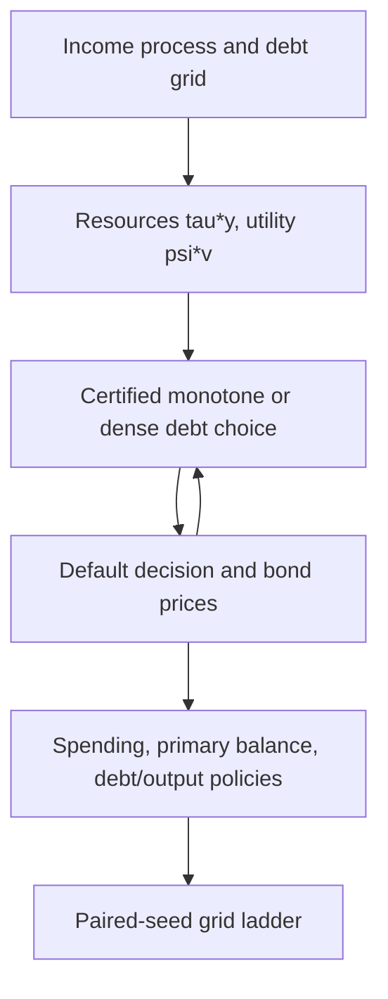

> 🇬🇧 English · 🇪🇸 [Español](es/sovereign_fiscal_rules.md)

# Fiscal block and fiscal rules in a sovereign default model

`solve_fiscal_sovereign_default` adds government spending to the short-term
Arellano (2008) sovereign default model. A fixed share of output is taxed,
the government borrows or saves in one-period bonds priced by risk-neutral
lenders, and spends what is left. The result reports spending, primary-balance
and debt-to-output policies next to the usual values, prices and default
probabilities.

## Model

Output $y$ follows the Tauchen AR(1) of `solve_sovereign_default`, normalized
to stationary mean one. With tax share $\tau$, private consumption is
$c=(1-\tau)y$ and public spending is

$$
g=\tau y-b+q(b',y)\,b'.
$$

The government values both:

$$
V^R(b,y)=\max_{b'}\; u\big((1-\tau)y\big)+\psi\, v(g)+\beta E[V(b',y')\mid y],
$$

$$
V^D(y)=u\big((1-\tau)h(y)\big)+\psi\, v\big(\tau h(y)\big)
+\beta E[\theta V(0,y')+(1-\theta)V^D(y')\mid y],
$$

with $V=\max(V^R,V^D)$ (log-sum-exp when `sigma_eps > 0`), CRRA $u$ and $v$
with curvatures `gamma_c` and `gamma_g`, and the Arellano default output
$h(y)=\min(y,0.969\bar y)$. Bond prices are $q(b',y)=E[1-d(b',y')\mid y]/(1+r^*)$.
The primary balance is $pb=\tau y-g=b-q\,b'$ and debt-to-output is $b'/y$.

Private consumption does not depend on the debt choice, so the choice is the
Arellano problem with resources $\tau y$ and utility $\psi v$; the private term
only shifts the repayment and default values, and therefore the default
decision and prices. `private_consumption=False` drops it.

## Units

Debt, spending and the primary balance are in units of **mean output per
quarter** (the model period). Mean output is one, so `debt_to_gdp = 0.02`
means debt equal to 2% of one quarter's output. An annual debt-to-GDP ratio is
**a quarter** of these numbers (2% of quarterly output is 0.5% of annual
output). Spreads are annualized, `4 * max(0, quarterly_yield - r_star)`.

## An illustrative calibration

`tau` and `psi` have no defaults. The call below is an **illustrative
calibration, not fitted to any data or target**: `tau = 0.20`, `psi = 1`,
`gamma_c = gamma_g = 2`, the public Arellano parameters (`beta = 0.95282`,
`r_star = 0.017`, `theta = 0.282`, `rho_y = 0.945`, `sigma_y = 0.025`) and the
public debt grid scaled by 0.2 (`b_min = -0.03`, `b_max = 0.066`).

```python
from puremacro.sovereign import solve_fiscal_sovereign_default

res = solve_fiscal_sovereign_default(tau=0.2, psi=1.0, n_b=101, n_y=11)
assert res.converged
assert res.metadata["monotone_certification_gap"] <= 1e-11
print(res.summary().tail(5))

path = res.simulate(periods=1000, seed=42)
print(path[["debt_to_gdp", "primary_balance", "g", "spread"]].describe())
```

`res.g_policy`, `res.primary_balance` and `res.debt_to_gdp` are `(n_b, n_y)`
arrays at each state's chosen debt `res.policy_index`; `res.g_default` and
`res.private_consumption_default` give the values in default.
`res.simulate()` starts at zero debt and the middle income node; its columns
include `gdp` (`y` when repaying, $h(y)$ otherwise), and
`g + private_consumption + primary_balance == gdp`. Its random stream differs
from `SovereignDefaultResult.simulate` for the same seed.
`res.spread_mean`, `res.spread_y_corr` and the spread rows of `res.summary()`
come from the solver's own diagnostic path (1,500 quarters, seed 42, no
burn-in), so they will not match the long paired-seed moments in the grid table
below.

## Search and certification

`policy_search="monotone"` (the default) searches the debt choice in
$O(n_b\log n_b)$ per income state, using the concavity of $\psi v$. It returns
the same values as `"dense"`, and the same policies except at exact value ties
between choices with different bond proceeds. After convergence a blocked
exhaustive search at the returned prices certifies it: a gap above `1e-11`
raises `RuntimeError`. If some candidate spending reaches the `1e-6` utility
barrier, the monotone search raises `ValueError`; use `policy_search="dense"`
there.
In dense mode such candidates are excluded by the barrier
`psi * (-1e12 + 1e6 g)`, whose strength scales with `psi`; it held for `psi`
from 1e-18 to 1 in a 61 × 7 grid with `b_max = 0.5`, but values of `psi`
below 1e-12 (a barrier worth less than one util) are not covered by tests.

## Reduction to the Arellano solver

With `tau=1`, `psi=1`, `gamma_g=gamma` and `private_consumption=False` the
fiscal model *is* the Arellano model, and the solver reproduces
`solve_sovereign_default` bit for bit (values, prices, policies, spreads and
iteration counts). This links the fiscal block to the solver validated in the
[Arellano replication](arellano_replication.md). With `tau=0.2`, the debt
grid scaled by 0.2 and still `private_consumption=False`, CRRA homogeneity
gives the same policies, default sets and prices, and values
$V_\tau=\tau^{1-\gamma}V_1+(\tau^{1-\gamma}-1)/((1-\gamma)(1-\beta))$ (for
$\gamma=1$, $V_1+\log\tau/(1-\beta)$); the tests check both. The illustrative
calibration switches private consumption on, so it is *not* a rescaled
Arellano model: the private term changes the default decision, prices and
debt.
`tau=1` with private consumption on is rejected (private consumption would be
zero).

```python
import numpy as np
from puremacro.sovereign import solve_sovereign_default

grid = dict(beta=0.95282, r_star=0.017, theta=0.282, b_min=-0.15, b_max=0.33,
            n_b=101, n_y=9, sigma_eps=0.0, y_penalty_type="arellano",
            enforce_monotonicity=False, tol=1e-10, max_iter=10000,
            policy_search="monotone")
fiscal = solve_fiscal_sovereign_default(tau=1.0, psi=1.0, private_consumption=False, **grid)
plain = solve_sovereign_default(gamma=2.0, **grid)
assert np.array_equal(fiscal.bond_price, plain.bond_price)
assert np.array_equal(fiscal.policy_b, plain.policy_b)
```

## Grid convergence

There is no independent fiscal reference. The grid ladder solves the public
solver at the illustrative calibration with the certified monotone search at
`n_b` = 1,601, 3,201, 6,401 and `n_y` = 321, 641, and simulates sixteen
paired seeds (1979-1994) of 500,000 quarters after a 1,000-quarter burn-in.
Tolerances are fixed before solving: 0.10 for percent moments and 0.02 for the
correlation, applied to the paired mean change plus its 95% Student-t
half-width for the final debt refinement (3,201 → 6,401 at 641 income states)
and the final income refinement (321 → 641 at 6,401 debt nodes).

Mean over the sixteen seeds. Debt/output in percent of quarterly output; spending/output in percent; spreads in percent per year.

| Grid (debt × income) | Debt/output (%) | Mean spread (%) | Annual default (%) | Spread SD (pp) | Spending/output (%) | corr(pb/y, log y) |
|---|---:|---:|---:|---:|---:|---:|
| 1,601 × 321 | 0.838 | 3.129 | 3.010 | 2.865 | 19.983 | -0.138 |
| 3,201 × 321 | 0.839 | 3.143 | 3.031 | 2.808 | 19.983 | -0.138 |
| 6,401 × 321 | 0.839 | 3.146 | 3.030 | 2.784 | 19.983 | -0.138 |
| 1,601 × 641 | 0.829 | 3.097 | 2.977 | 2.797 | 19.983 | -0.138 |
| 3,201 × 641 | 0.830 | 3.100 | 2.985 | 2.735 | 19.983 | -0.138 |
| 6,401 × 641 | 0.831 | 3.102 | 2.987 | 2.716 | 19.983 | -0.138 |

Verdict: **passed**. Every moment's paired change plus its 95% half-width fits its
tolerance in both final refinements; the largest is the spread standard deviation
in the income refinement, 0.070 pp against 0.10. Every solve converged with a
certification gap of 0 and no repayment period chose the top debt node.
Passing is not the same as no remaining drift: at 6,401 debt nodes the spread
standard deviation still falls from 321 to 641 income states (2.784 → 2.716 pp),
and the ladder has no 1,281-state rung to show where it settles. Treat its
third digit with the same caution as the [Arellano guide](arellano_replication.md)
applies to income-grid refinements.
Debt is low, about 0.83% of quarterly output (roughly 0.2% of annual output),
for the reason above: the debt choice scales with resources `tau*y`, so the
government carries about `tau` times the Arellano model's own debt, and
short-term-debt Arellano models carry little debt to begin with. Measured with
the same path engine on 801 × 161 grids (8 seeds × 100,000 quarters), the
public-calibration Arellano model (`tau=1`, private consumption off) holds
3.64% of quarterly output; `tau=0.2` without private consumption holds 0.727%,
exactly a fifth; switching private consumption on raises it to 0.86% (0.83%
on the finest grid above). That is about 4% of one quarter's tax revenue
(`tau` times mean output, 0.2).

```sh
MPLBACKEND=Agg python -m tools.reference_validation.check_fiscal_grids --output /tmp/fiscal-grids
```

The frozen record is `tests/fixtures/sovereign_fiscal/fiscal_grid_convergence.json`;
the tests recompute its verdict from the per-seed moments.

## Fiscal rules

`rule=FiscalRule(...)` restricts next debt in repayment. Lenders know the rule,
so it changes the equilibrium bond prices as well as the government's choices.

| Field | Meaning | Search |
|---|---|---|
| `debt_ceiling` | hard cap `b' <= debt_ceiling` | `"monotone"` (certified), `"exhaustive"`, `"dense"` |
| `escape_below` | the whole rule is suspended when `y < escape_below` | as the rule it suspends |
| `penalty` | every component becomes soft: each violated one costs `penalty` utils (violations add up) | as above |
| `deficit_limit` | `b' - b <= deficit_limit` (new net borrowing; negative means required debt reduction) | `"exhaustive"` or `"dense"` only |

Thresholds are in mean output per quarter, like debt: a ceiling of 0.02 is 2%
of one quarter's output, or 0.5% of annual output; `escape_below=0.92` is an
income 8% below its mean (about one unconditional standard deviation). A choice
at the cap up to a `1e-12` tolerance is compliant. A deficit limit links the
choice to current debt, which breaks the monotone search, so it raises
`ValueError` with `policy_search="monotone"`; the blocked exhaustive search costs
O(n_b² n_y) per iteration, so use coarse grids such as 401 × 21.

If a hard rule leaves a state with no admissible debt (for example
`deficit_limit=-0.01` at the lowest debt nodes), the solver raises before
solving and names up to ten such states; `infeasible="default"` instead makes
the government default there for sure (`v_repay = -inf`, `default_prob = 1`).

```python
from puremacro.sovereign import FiscalRule, solve_fiscal_sovereign_default

small = dict(tau=0.2, psi=1.0, n_b=101, n_y=11)
rules = {
    "ceiling": FiscalRule(debt_ceiling=0.02),
    "ceiling_escape": FiscalRule(debt_ceiling=0.02, escape_below=0.92),
    "soft_ceiling": FiscalRule(debt_ceiling=0.02, penalty=0.05),
    "deficit": FiscalRule(deficit_limit=0.005),
}
for name, rule in rules.items():
    search = "exhaustive" if rule.deficit_limit is not None else "monotone"
    res = solve_fiscal_sovereign_default(**small, rule=rule, policy_search=search)
    assert res.converged and res.rule is rule
    print(name, res.metadata["policy_search"], round(float(res.policy_b.max()), 4))

strict = FiscalRule(deficit_limit=-0.01)          # must cut debt by 1% of output each quarter
try:
    solve_fiscal_sovereign_default(**small, rule=strict, policy_search="exhaustive")
except ValueError as err:
    print(err)                                     # names the states with no admissible choice
forced = solve_fiscal_sovereign_default(
    **small, rule=FiscalRule(deficit_limit=-0.01, infeasible="default"), policy_search="exhaustive")
print(forced.metadata["rule_infeasible_states"])  # those states now default for sure
```

### Registered predictions and what happened

Before any rule was solved, the predictions below and their definitions were
committed in `tests/fixtures/sovereign_fiscal/rule_predictions_protocol.json`;
`tools/reference_validation/check_fiscal_rule_predictions.py` measured them
(record: `rule_predictions_record.json`; 16 paired seeds × 100,000 quarters).
Binding shares are measured on the **no-rule** paths: the share of repayment
quarters in which the unconstrained choice would break the rule.

To regenerate the record (about a minute; it reads the protocol and never changes it):

```sh
MPLBACKEND=Agg python -m tools.reference_validation.check_fiscal_rule_predictions --output /tmp/rule_predictions_record.json
```

| Prediction | Registered | Found | Verdict |
|---|---|---|---|
| Escape clause inert: largest debt chosen with `y < 0.92` | about 0.001, far below 0.02 | 0.00048 (401 × 21), 0.00060 (801 × 41); every moment unchanged | held |
| Ceiling 0.02 binds | 19–23% of repayment quarters | 23.4% | **not held** |
| Ceiling binds only in booms (`y > 1`) | all binding quarters | all | held |
| Deficit limit 0.005 binds | 1–2% | 1.7% | held |
| Output equivalent of `penalty=0.05` | about 0.002 | 0.0020 | reported (no band registered) |

The ceiling's binding share came out just above the registered band; it is
reported as found, and no threshold was changed afterwards.
For the escape-clause row, "held" is the tool's criterion: the largest debt
chosen with `y < 0.92` is below the 0.02 cap at both grids, and every moment
passes the paired comparison with the plain ceiling. The values found, 0.00048
and 0.00060, are about half the protocol's "about 0.001".

**Why the escape clause does nothing here.** Default risk is highest in bad
times, so lenders' prices already make borrowing in a recession expensive: with
income below 0.92 the unconstrained government never chooses more than
0.00048 of quarterly output, a fortieth of the cap. At those incomes the bond
price at the cap is essentially zero (at most 0.13% of the risk-free price), and
the most the government can raise by borrowing is 0.0011 of quarterly output
(401 × 21). Market discipline binds before the rule does, so suspending the rule in recessions changes nothing —
the escape-clause rows equal the plain ceiling on every seed. The ceiling binds
only in booms, when the government would otherwise borrow more.

**Penalty scale.** A penalty is in utils. Dividing it by the marginal utility
of spending, `psi g^(-gamma_g)`, averaged over the soft-ceiling model's
repayment quarters (mean `g` = 0.200), gives its output equivalent:
`penalty=0.05` costs about 0.0020 of quarterly output per violation. On the
simulated paths, which start from zero debt, the government never exceeds the
cap at that price (0.0% of repayment quarters), and at every current debt
`b <= 0.02` the soft and hard rules choose the same debt. Off those paths they
differ: in 503 repayment states, all with current debt of at least 0.04776, the
soft-rule government rolls its debt over above the cap and pays the penalty
rather than cut back to the cap at once. Paths that start from high debt, such
as debt-sustainability fan charts, would show that difference.

**COARSE 401 × 21 grid — compare rules only within this table.** Coarse
moments differ from converged ones (the no-rule spread SD is 5.906 pp here
against 2.716 at 6,401 × 641 above).

| Rule | Debt/output (%) | Mean spread (%) | Annual default (%) | Spread SD (pp) |
|---|---:|---:|---:|---:|
| `none` | 1.057 | 3.912 | 3.744 | 5.906 |
| `ceiling` | 0.796 | 3.726 | 3.569 | 5.698 |
| `ceiling_escape` | 0.796 | 3.726 | 3.569 | 5.698 |
| `soft_ceiling` | 0.796 | 3.726 | 3.569 | 5.698 |
| `deficit` | 1.053 | 3.908 | 3.739 | 5.902 |

The ceiling lowers average debt, and lower spreads and default frequency
accompany the lower debt; the deficit limit barely binds.

### Debt-sustainability trajectories from high debt

Ergodic simulations starting at zero debt never reach the states ($b \ge 0.04776$) where the soft ceiling and hard ceiling diverge. `simulate_fiscal_dsa` and `compare_fiscal_rules_dsa` instead start from an elevated initial debt state (default `b0 = 0.05` at boom output `y0 = 1.10`, where the sovereign is in good standing) and trace the 40-quarter transition distribution using common random numbers across rules.

On the **401 × 21** grid (`1,000` paths, `40` quarters, `seed = 42`, `threshold = 0.02`):

| Rule | Period-1 next debt $b'_1$ | Period-1 spending/output (%) | Period-1 above 0.02 (%) | Repay quarters above 0.02 (%) | Terminal median debt (%) | Terminal $\text{DaR}_{95}$ (%) | Cumulative default (%) |
|---|---:|---:|---:|---:|---:|---:|---:|
| `none` | 0.03960 | 18.99 | 100.0 | 46.74 | 0.816 | 4.225 | 30.50 |
| `ceiling` | 0.01992 | 17.22 | 0.0 | 0.00 | 0.792 | 1.992 | 26.60 |
| `ceiling_escape` | 0.01992 | 17.22 | 0.0 | 0.00 | 0.792 | 1.992 | 26.60 |
| `soft_ceiling` | 0.03600 | 18.67 | 100.0 | 2.56 | 0.792 | 1.992 | 26.90 |
| `deficit` | 0.03960 | 18.99 | 100.0 | 46.58 | 0.768 | 4.225 | 30.50 |

Starting from $b_0 \approx 0.05$, the **hard ceiling** (`ceiling`) forces a one-quarter fiscal contraction from $b_0 = 0.04992$ all the way down to $b'_1 = 0.01992 \le 0.02$, cutting first-period public spending to $17.22\%$ of output ($-1.77\text{ pp}$ below `none`). Under the **soft ceiling** (`soft_ceiling`, `penalty = 0.05`), the government instead pays the utility penalty in period 1 to choose an intermediate debt $b'_1 = 0.03600 > 0.02$, smoothing first-period public spending at $18.67\%$ of output ($+1.45\text{ pp}$ above the hard ceiling) before completing its deleveraging below the $0.02$ cap in period 2 (`2.56%` of repayment quarters above the cap overall, with the same $1.992\%$ terminal $\text{DaR}_{95}$ as the hard ceiling).

```python
from puremacro.sovereign import compare_fiscal_rules_dsa, simulate_fiscal_dsa

dsa_models = {
    "none": solve_fiscal_sovereign_default(**small),
    "ceiling": solve_fiscal_sovereign_default(**small, rule=rules["ceiling"]),
    "soft_ceiling": solve_fiscal_sovereign_default(**small, rule=rules["soft_ceiling"]),
}
dsa_table = compare_fiscal_rules_dsa(dsa_models, b0=0.05, y0=1.10, horizon=20, n_sims=200, seed=42)
assert dsa_table.loc[dsa_table["rule_name"] == "ceiling", "prob_breach_pct"].item() == 0.0
assert dsa_table.loc[dsa_table["rule_name"] == "soft_ceiling", "first_period_above_threshold_pct"].item() == 100.0
soft_dsa = simulate_fiscal_dsa(dsa_models["soft_ceiling"], b0=0.05, y0=1.10, horizon=20, n_sims=200, seed=42)
print(dsa_table[["rule_name", "first_period_b_next", "first_period_g_pct", "dar_95_pct"]])
```

## Limits

- Endowment economy: output does not respond to taxes or spending.
- Fixed tax share: `tau` is a parameter, not a policy choice.
- Short-term debt only (`delta = 1`, `kappa = 0`).
- Rules are fully credible and permanent; the government cannot renegotiate them.
- The calibration is illustrative and the moments describe this model at
  these parameters, not any country.


