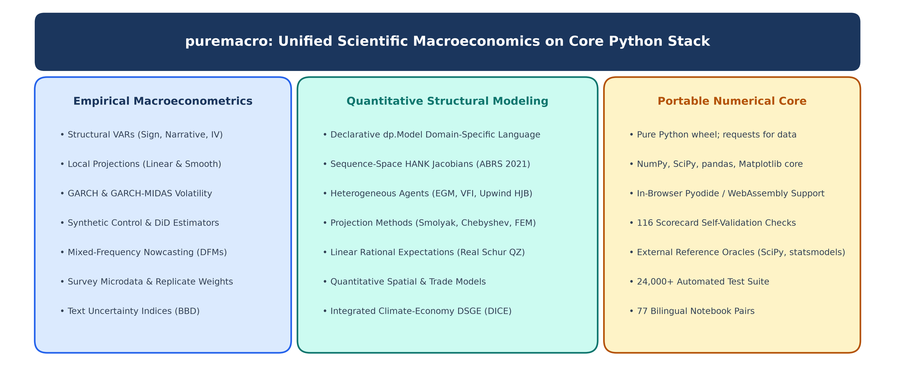

<!-- Evidence snapshot. The validation-gallery counts (checks, subsystems, kinds
     of reference), Pyodide 0.28.3 gallery run, `scorecard.png` and the scale
     counts below were recomputed on 2026-11-12 on the 6.4.0 release tree
     (commit 49975437): 116 checks, 16 subsystems, 22 external (15 package +
     5 SciPy + 2 published) / 31 analytical / 63 internal, all passing (5.4.0
     had 113: 20 / 31 / 62; 4.6.0 had 114 with four trade cases; 4.4.0 had
     110: 20 / 31 / 59; 3.4.0 had 107: 19 / 29 / 59); 978 package Python
     modules, 357,863 lines of Python, 756 shippable library modules swept by
     the import invariant, 24,099 default / 24,359 total collected tests, 77
     bilingual showcase notebook pairs (plus 2 non-numbered research pairs), 22
     course lesson notebooks (20 importing puremacro), and 513 of 918 commits
     on origin/main carrying a Claude co-author trailer. On 2026-11-12 Pyodide
     0.28.3 passed all 116 gallery checks in Node.js (plus 121 smoke tests);
     Pyodide 314.0.5 had earlier passed the 110-check gallery on 2026-10-13.
     The krusellsmith1998 and dolo entries in paper.bib were not checked
     against Crossref from this session. Re-run the commands in RELEASING.md
     §6.5 on the chosen submission commit before submitting. -->

# Summary

`puremacro` is a Python library for empirical macroeconomics and for solving
quantitative macroeconomic models (\autoref{fig:graphical_abstract}). It gives
researchers, instructors and students one consistent interface to the field's
standard methods, and a way to check the library's numbers on the machine that
produces them.

{ width=100% }

On the empirical side it covers vector autoregressions (VARs) with recursive,
long-run, sign, sign–zero, narrative and external-instrument identification
[@sims1980; @blanchardquah1989; @uhlig2005; @rubioramirez2010; @antolindiaz2018; @mertensravn2013; @stockwatson2018];
factor-augmented VARs [@bernanke2005]; local projections [@jorda2005]; ARCH, GARCH
and GARCH-MIDAS volatility models [@engle1982; @bollerslev1986; @engleghyselssohn2013];
autocorrelation-robust and weak-instrument-robust inference
[@neweywest1987; @andersonrubin1949; @oleapflueger2013]; dynamic panels
[@arellanobond1991]; difference-in-differences and synthetic control
[@abadie2010; @arkhangelsky2021]; mixed-frequency nowcasting
[@giannone2008; @banburamodugno2014]; and text-based uncertainty indices
[@bbd2016]. On the modelling side it solves heterogeneous-agent
economies, including sequence-space HANK models
[@aiyagari1994; @young2010; @auclert2021]; continuous-time models [@achdou2022];
projection methods on Chebyshev, finite-element and Smolyak grids
[@judd1992; @mcgrattan1996; @smolyak1963; @kruegerkubler2004]; linear
rational-expectations (DSGE) models; quantitative spatial models
[@allenarkolakis2014]; and climate–economy models
[@nordhaus2018; @golosov2014].

Dynamic programs are declared rather than coded: in the spirit of Dynare's model
files, a `dp.Model` takes states, shocks, choices, a reward, constraints and a
market-clearing condition as equations and compiles them to value-function
iteration, endogenous grids with optional discrete choices
[@carroll2006; @iskhakov2017], a continuous-time upwind scheme [@achdou2022] or a
Krusell–Smith loop [@krusellsmith1998]. A data layer fetches macroeconomic series,
policy texts (as sparse document-term matrices) and survey microdata with their
replicate weights (Census ACS and CPS, the Survey of Consumer Finances, Mexico's
ENIGH), so that moments carry design-based standard errors.

Its estimators and solvers are written against NumPy [@numpy2020], SciPy
[@scipy2020], pandas [@mckinney2010] and Matplotlib [@hunter2007] alone, and the
package contains no compiled code of its own. The same code therefore also runs
in a web browser under Pyodide [@pyodide], which ships those libraries compiled
to WebAssembly.

# Statement of need

An applied macroeconomist's toolkit typically spans several ecosystems:
reduced-form time series and panel econometrics from Python's statsmodels
[@statsmodels2010], arch [@arch] and linearmodels [@linearmodels]; structural
identification from MATLAB toolboxes or R packages such as vars and lpirfs
[@pfaff2008; @adammer2019]; DSGE analysis in Dynare [@dynare2024], which runs
under MATLAB or GNU Octave; and heterogeneous-agent models in Python codes
accelerated with Numba [@auclert2021; @carroll2018hark; @quantecon2024]. Each tool
has its strengths, but combining them requires several installations, languages
and conventions, sometimes with a commercial licence. Installation problems
consume class time, and students' managed laptops or tablets may not support
the full stack.

`puremacro` is written for instructors, students and applied researchers in
macroeconomics. It puts common estimators and models behind one
set of conventions (shared arguments such as `lags`, `horizon` and `ci`, and
immutable result objects with plotting and table export) and ships the evidence
needed to trust its output: galleries of checks that users can run themselves.
One interface spans data and models: a worked example calibrates an Aiyagari economy's
discount factor to the median wealth-to-income ratio in the 2025 Survey of
Consumer Finances, carrying the target's sampling error into the parameter, and
sets untargeted moments against the data (wealth Gini 0.59 against 0.82).

# State of the field

statsmodels, arch and linearmodels are the reference Python implementations of
reduced-form time series, conditional volatility and panel and
instrumental-variable estimation. `puremacro` does not aim to replace them; it
uses them as test oracles. They do not, however, implement
the identification schemes that define structural macroeconometrics (sign,
sign–zero, narrative and external-instrument restrictions), nor do they solve
heterogeneous-agent or general-equilibrium models. For models, widely used tools
are Dynare, the sequence-space Jacobian toolkit, HARK and QuantEcon.py; dolo
[@dolo] declares models in files and solves them by time iteration. In their
domains they are more mature than `puremacro` and, for large heterogeneous-agent
problems, faster: `puremacro` trades speed for portability.

As of September 2026 the Pyodide distribution includes NumPy, SciPy, pandas,
Matplotlib and statsmodels, but not arch, linearmodels or Numba. HARK, QuantEcon.py
and dolo require Numba, while arch and linearmodels provide no pure-Python browser wheels.
In a browser, the volatility, panel-IV and heterogeneous-agent layers
of the usual stack are therefore unavailable, and Dynare requires a separate language
runtime altogether.

Individual estimators could be contributed to existing packages. The collection's
portability, however, depends on a library-wide invariant: one import surface
whose numerical code uses only four core libraries, and contributing an estimator elsewhere
would not change its host's dependency graph.

# Software design

The overall modular architecture is illustrated in \autoref{fig:architecture}.

{ width=90% }

**An import invariant.** Library modules import NumPy, SciPy, pandas and
Matplotlib (plus requests, in the data layer) at module scope; anything else is
imported only when available. Two tests enforce the rule against the packages most
likely to leak in.
The first imports each of the 756 shippable library modules (examples, teaching helpers,
text-scraping sources and optional Numba kernels are excluded) and fails if
statsmodels, linearmodels, arch or the scraping packages bs4, pdfplumber and pypdf
have entered `sys.modules`. The second repeats the sweep with those packages
blocked, so a module that needs them fails in continuous integration (CI) even
where they are installed. The
wheel is pure Python, and its base install adds only requests to the four core
libraries.

**Oracles that do not ship.** The packages forbidden at run time are the test
suite's references. Repository scripts run statsmodels, arch, linearmodels and
esda once on fixed inputs and store their outputs as package data, so the
validation gallery can compare against them without importing them; an opt-in test
marker recomputes the stored outputs with the installed packages to detect drift.

**Degrading rather than failing.** Where an external tool does better, `puremacro`
uses it if present: seasonal adjustment calls X-13ARIMA-SEATS through statsmodels
when both are installed and otherwise falls back to a native X-11. A `runtime`
module detects the host (CPython or Pyodide) and the four capabilities that differ
away from a workstation (sockets, Parquet, threads and a
writable filesystem), and offers opt-in adaptations such as a browser `fetch`
transport. Some solvers have optional Numba kernels and experimental MLX and CuPy
paths; NumPy remains the reference path, tested in CI.

**Costs.** Writing everything in vectorised NumPy makes large heterogeneous-agent
problems slower than in JIT-compiled toolkits, and derivatives that other libraries
obtain by automatic differentiation must be coded by hand. The browser is a
best-effort target rather than a supported one: Parquet and Excel files need
engines that not every Pyodide distribution provides. On
12 November 2026 a headless Node.js harness ran the full validation gallery inside
Pyodide 0.28.3: all 116 checks passed (as did 121 smoke tests).

**Scale.** Version 6.4.0 contains 978 package Python modules and approximately
358,000 lines of Python, including 756 shippable library modules checked by the
import sweep. More than 24,000 automated tests cover the package. CI runs the
default selection on Linux, macOS and Windows under Python 3.11–3.13; slow,
reference and replication tests run weekly and on release tags, where they gate publication.
Before each release tag, a script checks the suite against a recorded baseline,
the import invariant and a snapshot of the public API.

## Verification

The gallery counts below and the scale measurements above were recomputed on
2026-11-12 on release 6.4.0.

The validation gallery, `puremacro.validation.scorecard()`, runs 116 checks across
16 subsystems in under a minute, with none of the oracle packages installed; all
pass (\autoref{fig:scorecard}). The checks differ in strength, and each records
its reference. Twenty-two compare against an external reference: stored outputs of
statsmodels, arch, linearmodels and esda, SciPy results computed at run time, or a
published table. Agreement with independent implementations is typically at
machine precision (median relative difference of order $10^{-15}$); the exception
is GARCH, whose estimates differ from arch's by up to 0.35% because the two
packages use different optimisers. Thirty-one checks compare against analytical
results and 63 test internal consistency.

A separate replication gallery, `puremacro.replication.scorecard()`, reproduces
published estimates of the return to schooling [@card1995], a textbook logit of
married women's labour-force participation on Mroz's [-@mroz1987] data, and the
output effect of tax changes [@romer2010], and two qualitative predictions of
incomplete-markets models [@huggett1993; @aiyagari1994]: the equilibrium interest
rate lies below the rate of time preference and falls as income risk rises. Most model solvers (sequence-space, continuous-time, spatial,
and climate) are covered by unit tests but not yet by gallery checks.

![The validation gallery of `puremacro`: 116 checks in 16 subsystems, by kind of reference; all pass. *External reference*: stored outputs of statsmodels, arch, linearmodels or esda, SciPy computed at run time, or a published table. *Analytical result*: a closed form, or an effect planted in simulated data. *Internal consistency*: agreement between alternative algorithms, identities that correct output must satisfy, or recovery of parameters from simulated data. Regenerate with `python paper/make_scorecard_fig.py`.\label{fig:scorecard}](scorecard.png){ width=80% }

# Research impact statement

`puremacro` is young (public since July 2026) and has not yet been used in
published research or by other packages. Its significance is near-term, and rests
on evidence a reviewer can check.

*Teaching.* The library was written for, and is used in, the author's course
*Macroeconomía Avanzada* at ITAM, whose Fall 2026 edition builds its computational
material on it. The course's 22 Spanish lesson notebooks are in the repository
(`notebooks/course`), and 20 of them call `puremacro` directly.

*Reproducible material.* The repository contains 77 bilingual (English/Spanish)
pairs of worked-example notebooks; all of them, with the lesson notebooks, are also
published as a JupyterLite [@jupyterlite] site that runs them in the browser.

*Community readiness.* The package is released on PyPI under the MIT licence, with
documentation at <https://jalonso1979.github.io/puremacro/>, contribution
guidelines, and CI on three operating systems.

# AI usage disclosure

Generative AI was used extensively in writing `puremacro`, its documentation and
this paper. Anthropic's Claude models, used through the Claude Code agent (Claude
Opus 5, Claude Opus 5.5, Claude Fable 5, Claude Fable 5.1 and Claude Sonnet 5.5), generated or
co-wrote much of the code, tests, documentation and notebooks: 513 of the 918
commits in the 6.4.0 public repository carry a Claude co-author trailer. Google's Jules coding agent
contributed 20 pull requests (refactoring, performance and test improvements),
each reviewed and merged by the author. Claude also drafted and revised this
paper, including checking its claims against the code and its references against
Crossref.

The author set the scope and made the core design decisions (the import
invariant, validation against stored outputs of reference implementations, and
the shared interface conventions) and reviewed, edited and validated all
AI-assisted output before it was merged. Correctness does not rest on that review
alone: it is checked by the test suite, the validation and replication galleries,
and CI.

<!-- AUTHOR, required before submitting (JOSS treats an incomplete or inaccurate
     disclosure as an ethical breach). Only you can confirm items 1-4; do not
     submit with this comment still here.
     (1) TOOLS AND MODELS, PUBLIC PERIOD (2026-07-20 onward). The commit trailers
         on origin/main at 49975437 (6.4.0) name: Claude Opus 5.5 (226 commits),
         Claude Opus 5 (105), Claude Fable 5.1 (69), Claude Opus 5.5 (1M context) (62),
         Claude Opus 5 (1M context) (26), Claude Fable 5 (14) and Claude Sonnet 5.5 (12);
         the sentence above names all five model families. Confirm any additional
         assistants (OpenAI Codex, Gemini/Antigravity, Copilot, ChatGPT, Cursor, ...)
         used without leaving commit trailers (notably between 5.4.0 and 6.4.0).
     (2) TOOLS AND MODELS, PRIVATE PERIOD (2026-04-28 to 2026-07-20, inside the
         private monorepo and squashed into the first
         public commit, so no trailer records it): list every AI tool and model
         used then, and say roughly how much of the code it produced. The
         sentence above currently covers only the public repository.
     (3) JULES: 20 commits by google-labs-jules[bot], merged through 20 pull
         requests, are on origin/main. Name the model and version behind Jules
         (the commits do not record it), and confirm "each reviewed and merged
         by the author".
     (4) REVIEW ASSERTION: confirm that "reviewed, edited and validated all
         AI-assisted output before it was merged" is literally true, including
         for multi-agent workflow commits; if not, soften it to what is true.
     (5) COUNTS ("513 of the 918 commits"): recomputed on 2026-11-12 at
         49975437 (6.4.0) with RELEASING.md §6.5, i.e.
         `git rev-list --count origin/main` and
         `git log origin/main -i --grep='co-authored-by: claude' --oneline | wc -l`.
         Re-run on the submitted commit; commits after 6.4.0 will move both. -->

# Acknowledgements

The author thanks the scientific-Python and Pyodide communities, whose work makes
a browser-capable macroeconomics library possible.

# References
